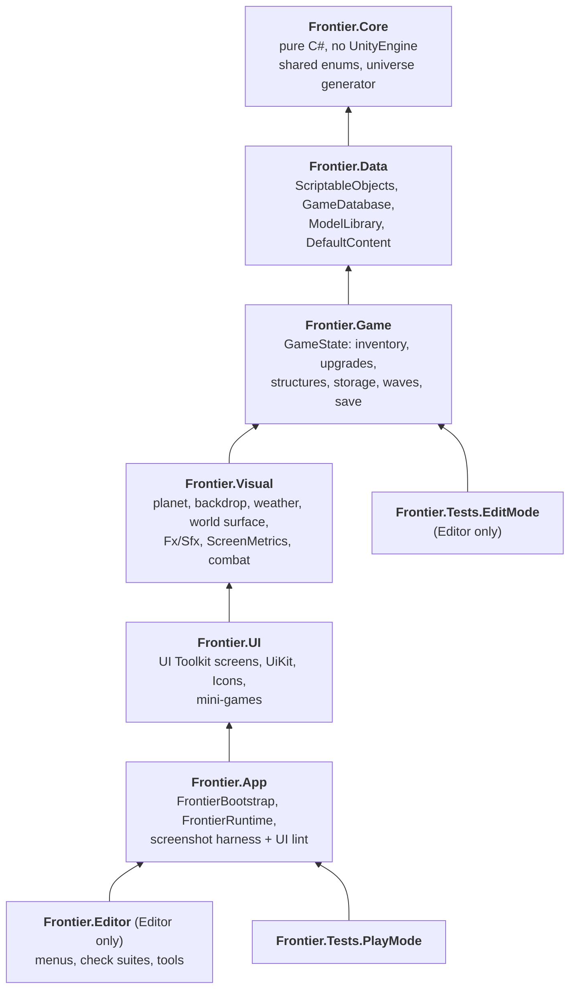

# Architecture and workflow

## Assemblies (`SpheerURP/Assets/Frontier`)

Code is split into assembly definitions that form one downward chain. An assembly may reference only the ones below it, so a
forbidden dependency (a data asset reaching into rendering, game logic reaching into the UI) does not compile.



| Assembly | Folder | Contents | Engine |
|----------|--------|----------|--------|
| `Frontier.Core` | `Scripts/Core` | `GameEnums` (`StructureKind`, `MinigameKind`, `UpgradeEffect`, `WeatherKind`, ...); `Universe/`: the infinite deterministic universe generator (namespace `Frontier.Universe`, 15 files) | **none** (`noEngineReferences`) |
| `Frontier.Data` | `Scripts/Data` | `ResourceSO`, `PlanetSO`, `StructureSO`, `RecipeSO`, `UpgradeSO`, `EnemySO`, `WaveFormulaSO`, `GameDatabase`, `FrontierSettings`, `ModelLibrary`, `ItemAmount`, `PlanetGenerator`, `DefaultContent` | UnityEngine |
| `Frontier.Game` | `Scripts/Game` | `GameState` (+ `SaveData`, `PlacedStructure`, `WarehouseStorage`): the whole non-rendering game model and the save file | UnityEngine |
| `Frontier.Visual` | `Scripts/Visual` | `PlanetView`, `SpaceBackdrop`, `Weather`, `WorldSurface` (structures, pads, picking), `Fx` + `Sfx`, `ScreenMetrics`; `Combat/`: `DefenseController`, `AlienActor` | UnityEngine, URP |
| `Frontier.UI` | `Scripts/UI` | `UIRoot*.cs` partials, `UiKit` (tokens mirror, buttons, chips), `Icons`; `Minigames/`: `Minigame` base, `NodeGame`, `DrillGame`, `TravelGame`, `MinigameStage` | UI Toolkit, URP |
| `Frontier.App` | `Scripts/App` | `FrontierBootstrap` (scene entry), `FrontierRuntime`; `Harness/`: `HarnessRunner`, `UiLint` (compiled only in the editor and development builds) | everything |
| `Frontier.Editor` | `Editor` | menu tools and validation suites (`Frontier.EditorTools.*`) | UnityEditor, all of the above |
| `Frontier.Tests.EditMode` | `Tests/EditMode` | NUnit tests for Core, Data and Game (`Core/`, `Universe/`, `Game/`); Editor only | UnityEditor, Test Runner |
| `Frontier.Tests.PlayMode` | `Tests/PlayMode` | smoke tests that boot the real session; the universe golden digest (so it can also run on a device) | everything |

All asmdefs are `autoReferenced: false` and reference each other by name. There is no `Assembly-CSharp` any more: a script placed
outside the folders above would compile into a new one that cannot see any Frontier type, so every new script goes under one of them.

Why these boundaries (and not one assembly per folder):

* **Visual + Combat, UI + Mini-games are merged on purpose.** Combat sits on top of `WorldSurface`/`PlanetView`/`Fx`, nothing in Visual
  calls into it, so a separate assembly would only add a reference. The mini-games are UI Toolkit overlays built with `UiKit`, and
  `UIRoot` starts them directly, so splitting them from `UIRoot` would force a cycle (`UI -> Minigames -> UiKit`) or a third "kit"
  assembly. Both can be split later without code changes (move the folder, add an asmdef) if they grow.
* **The low-level helpers sit at the bottom of the presentation layers.** `Fx`/`Sfx` and `ScreenMetrics` are used by every presentation
  class, so they live in Visual; the colour clamp that `WorldSurface` and `AlienActor` borrowed from `UiKit` is now `Fx.Displayable`
  (`UiKit.Ui` forwards to it). `PlanetSO.StandardSurfaceRadius` replaced `PlanetView.Radius` as the source of truth, which removed the only
  `Data -> Visual` edge (`PlanetView.Radius` still exists and aliases it).
* **The harness lives in `Frontier.App`.** It drives the live `FrontierRuntime`, which only the bootstrap can publish, so a
  separate Harness assembly would be a cycle. Its code is wrapped in `#if UNITY_EDITOR || DEVELOPMENT_BUILD`.
* Assembly count stays small on purpose: seven runtime/editor assemblies plus two test assemblies. Every assembly adds reload and
  reference overhead; the single downward chain is what protects the layering.

Rules of the road for the assemblies:

* **Core is pure.** No `UnityEngine`/`UnityEditor`, no `System.Random`, `string.GetHashCode`, `DateTime.Now` in anything that must be
  deterministic. Anything you want to unit test without Unity or run off the main thread belongs here.
* **Data holds only authored data and its lookups.** No GameObjects, no rendering, no UI.
* **Game has no rendering and no UI.** Presentation observes it through events (`GameState.Changed`, `PlanetView.Rebuilt`), never the
  other way round.
* **Visual knows nothing about UI Toolkit screens; UI knows Visual.** Pass data or delegates upward instead of reaching down
  (`FrontierBootstrap` wires `IsOverUi`, `Rebuilt`, ... for exactly this reason).
* **Nothing references `Frontier.Editor`.** Editor-only code never leaks into player builds.
* Keep namespace `Frontier` for runtime code (the assembly is not a namespace); editor tools use `Frontier.EditorTools`.

### Where new code goes

| You are adding | Put it in |
|----------------|-----------|
| An enum or POCO shared by data, logic and rendering; hashing, noise, universe generation, score or economy formulas | `Frontier.Core` (stay engine-free) |
| A ScriptableObject type, a content table, a data lookup | `Frontier.Data` |
| Inventory, wallet, timers, progression, save/load, anything the UI reads but that draws nothing | `Frontier.Game` |
| A MonoBehaviour that draws or animates the world (planet, structures, enemies), shared FX/audio, device metrics | `Frontier.Visual` |
| A screen, panel, widget, icon, mini-game | `Frontier.UI` |
| Scene entry, wiring of the pieces above, debug/harness hooks | `Frontier.App` |
| A menu item, importer, validation suite | `Frontier/Editor` (`Frontier.EditorTools`) |

If code seems to need a type from a layer above, the type is in the wrong place or an event/delegate is missing; do not add a
reference upward.

## Code map (`SpheerURP/Assets/Frontier`)

| Folder | Contents |
|--------|----------|
| `Scripts/Core` | `Frontier.Core`: `GameEnums.cs`; `Universe/` (15 files): the pure, deterministic universe generator |
| `Scripts/Data` | `Frontier.Data`: ScriptableObject definitions (`ResourceSO`, `PlanetSO`, `StructureSO`, `RecipeSO`, `UpgradeSO`, `EnemySO`, `WaveFormulaSO`, `GameDatabase`, `FrontierSettings`, `ModelLibrary`), `ItemAmount`, `PlanetGenerator`, `DefaultContent` |
| `Scripts/Game` | `Frontier.Game`: `GameState`: inventory, upgrades, structures, storage, waves, travel, save/load (to be split, see roadmap) |
| `Scripts/Visual` | `Frontier.Visual`: planet view, space backdrop, weather, world surface (structures, pads, picking), FX and procedural audio, `ScreenMetrics`; `Combat/` holds `DefenseController` and `AlienActor` |
| `Scripts/UI` | `Frontier.UI`: UI Toolkit interface built in code: `UIRoot*.cs` partials, `UiKit` (tokens mirror, buttons, chips), `Icons` (SVG icon loader and name lookups); `Minigames/` holds the `Minigame` base, Chop/Mine (`NodeGame`), `DrillGame`, `TravelGame`, `MinigameStage` (off-screen 3D stage shown in a UI element) |
| `Scripts/App` | `Frontier.App`: `FrontierBootstrap`, `FrontierRuntime`; `Harness/` is the screenshot harness runtime and UI lint (compiled only in the editor and development builds) |
| `Art` | models, model prefabs, materials, `Fonts` (Chakra Petch and Barlow TTFs, OFL licences, generated SDF FontAssets) |
| `Resources/Frontier` | data assets, shaders, `Tokens.uss` + `Frontier.uss`, `Icons/*.svg`, panel settings, `ModelLibrary` |
| `Editor` | `Frontier.Editor`: menu tools and validation scripts |
| `Tests` | `EditMode/` (`Core/`, `Universe/`, `Game/`) and `PlayMode/` NUnit tests, see [TESTING.md](TESTING.md) |

`tests/` at the repository root holds the plain .NET projects that compile `Frontier.Core` (netstandard2.1) and run the engine-free
tests without Unity; it sits outside `SpheerURP/` so Unity never imports it.

`FrontierBootstrap` (the only object in `Scenes/Frontier.unity` besides a camera and light) builds the camera, post-processing,
planet, backdrop, defense, UI and world surface from the `GameDatabase` asset, then publishes a `FrontierRuntime`.

## Rules of the road

- **Never read `Screen.*` directly in game or UI code.** Use `ScreenMetrics` (size, safe area, density) so the screenshot harness
  and layout tests can render any virtual device.
- **Tools and tests must not touch the real save.** Set `GameState.SaveDirectoryOverride` first (`CheckSupport.IsolateSaves()` in
  editor checks, `SaveSandbox` in EditMode tests, handled automatically by the harness).
- **Never modify a loaded asset at runtime.** `FrontierBootstrap` instantiates its `PanelSettings`; do the same for any other
  asset you need to change in play mode, otherwise Unity serializes the change back into the asset.
- Data lives in ScriptableObjects under `Resources/Frontier`. `DefaultContent` only bootstraps missing data.
- Text files are stored with LF (`.gitattributes`). Commit messages end with the Copilot co-author trailer.

## Editor tools (Frontier menu)

| Menu | Purpose |
|------|---------|
| Generate Editable Data Assets / Generate Deep Space Planets | bootstrap or extend data assets |
| Build Model Library / Calibrate Model Scales | rebuild the model library and bake scale corrections |
| Validate Planet Model Sizes / Storage / Combat Balance / Panel Layout / Icons | validation suites (the batch gate, see [TESTING.md](TESTING.md)) |
| Universe > Render Density PNG | draws the galaxy density map of the universe generator (30,000 ly across) to `SpheerURP/Screens/universe/` |
| Build Font Assets | regenerate the SDF FontAssets next to the TTFs in `Art/Fonts` |
| Capture Screens | screenshot harness from inside the editor |
| Apply Mobile Project Settings | portrait lock, IL2CPP, ARM64, stripping |
| Reset Save | delete the local save |

## Command line (PowerShell)

All scripts live in `tools/`. If script execution is disabled, prefix with `powershell -NoProfile -ExecutionPolicy Bypass -File`.

```powershell
tools/run-unity.ps1 -Method Frontier.EditorTools.FrontierPlanetChecks.Run          # any editor method, with watchdog + lock
tools/run-unity.ps1 -Method Frontier.EditorTools.FrontierLayoutChecks.Run -NoQuit   # checks that exit by themselves
tools/run-checks.ps1 [-Only Storage,Layout]                                        # the five check suites (the gate)
tools/run-tests.ps1 -Platform EditMode|PlayMode [-TestFilter ...] [-ShowAll]       # Unity Test Framework, pass/fail summary
tools/capture-screens.ps1 [-Devices phone-1080x1920] [-Only hud,map]               # screenshots + report.json (UI lint)
tools/contact-sheet.ps1 -Dir SpheerURP/Screens/<run>/phone-1080x1920               # labelled overview sheets
tools/image-diff.ps1 -A <runA>/<device> -B <runB>/<device>                         # per-screen visual regression numbers
cd tests; dotnet test Frontier.Core.Tests/Frontier.Core.Tests.csproj               # engine-free tests, no Unity needed
```

Virtual devices: `phone-1080x1920`, `phone-1170x2532`, `phone-1440x3200`, `tablet-1536x2048`, plus the opt-in 360 dp phone
`phone-1080x2340` (only rendered when named in `-Devices`). Besides the screens, the harness captures the icon contact sheets
(`icons-ui`, `icons-items`, `icons-color`) and `menu-release` (the menu as a release build sees it, without the DEBUG tile).

Unity runs are serialised through a named mutex because only one editor can open the project. Do not pass `-nographics` to anything
that renders. The harness writes to `SpheerURP/Screens/<timestamp>/` (git-ignored).

## Where this is going

See [ROADMAP.md](ROADMAP.md): infinite deterministic universe with delta saves, ~34 resources and an Atlas, a Hyperspace Run
shooter for travel, new harvest games, timers/obstacles, premium currency and rewarded ads, leaderboards, cinematics and release
readiness. Baseline UI findings are in [AUDIT.md](AUDIT.md); the design system (tokens, fonts, icons) is in [DESIGN.md](DESIGN.md);
today's behaviour is in [SYSTEMS.md](SYSTEMS.md).
