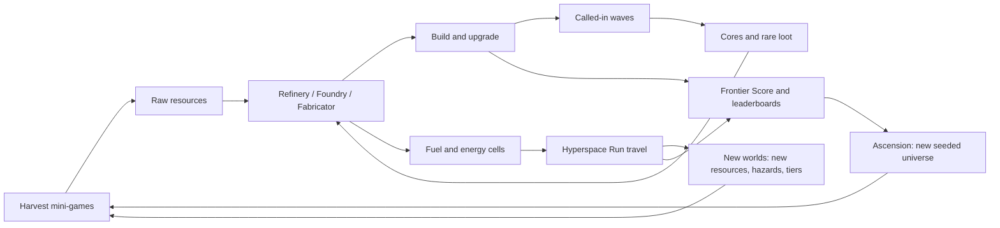
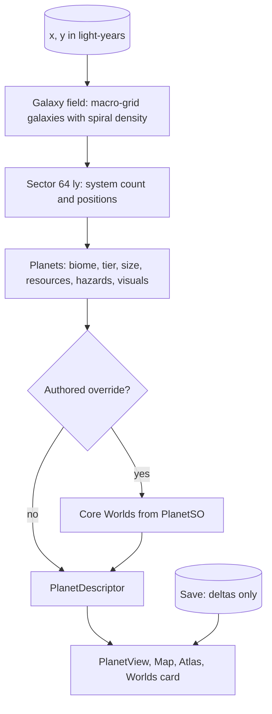

# Frontier → Production: Master Plan

Branch `20cameronw-spheer-rework-uitoolkit` · PR #42 · Unity 6000.4.0f1 · URP 17.4 · UI Toolkit · portrait only.
Status: **approved. Phase A is complete; Phase B (universe/travel) and Phase C (gameplay expansion) are in progress**; the todo list and progress live below.
The subsequent **objectives/achievements milestone is complete**: 26 authored one-time goals, persistent completion/claim
records, actionable Goals UI and bounded rewards (275 shards at current tuning, already represented in simulator
milestones). Old saves baseline completed goals without payouts. Full engine-free: 444 passed; Unity EditMode:
705 passed / 2 runtime skips; PlayMode: 34 passed; all five editor checks and final phone captures passed.
Optional Ascension remains unfinished and disabled while its unspecified permanent-bonus design is unresolved; continue other approved
checklist work instead of assuming balance values. Prior verified milestones include
mobile presentation budgets, live eras, harvest feedback, contextual onboarding and actionable empty states.
Production audio/FX integration, remaining provider integrations and external activation/device/release gates remain open.
Licensed CC0 UI/combat/wood-stone-metal harvest and ship cues now ship in an editable cue library with retained
Kenney source licenses; the bounded mixer/volume/mute path remains unchanged. Adaptive exploration/combat/travel
playback, four weather textures and a shared licensed engine loop are implemented through an editable
soundscape library without adding audio sources. The initial music is original editor-baked material, not
the planned approved commercial music-pack/stem selection. Final biome direction, music selection and
physical-device sound sign-off remain open. Consent-gated Analytics and Remote Config adapters are implemented but disabled by default. Automatic cloud sync/upload and
competitive score writes stay off; Cloud Save/account recovery remain disabled pending platform/legal setup.
Paid-history saves now refuse gameplay reset and cloud restore/undo until authoritative purchase recovery
is configured, including equal-journal restores that could roll back spending. Settings explains refusal
without replacing current data. Purchase-free resets/restores are unchanged; this safety gate does not
complete native IAP, backup/cross-device reconciliation or store recovery policy.
Offline production now retains a greatest-observed UTC watermark across saves/restarts and explicit
restore/undo. Rewound clocks warn and cannot re-credit an already-observed production interval; older saves
derive the watermark from their last save time, and corrupt history is protected read-only. Forward edits,
manual file/automatic-backup replacement and cross-device time remain untrusted and require server authority.

### Execution status: unfinished is not the same as running

The old in-progress indicators included milestones waiting on external acceptance or undecided requirements.
Those milestones are now tracked as **blocked**, not complete or actively running. Some also contain unfinished
code that depends on the listed prerequisite; this is not a claim that only testing remains.

| Remaining work | Execution state / prerequisite |
| --- | --- |
| Remaining generated/provider localization | Pending local implementation; generated-world and authored-content presentation, language selection and live switching are implemented. Only English is shipped. |
| Durable Hyperspace process-restart restoration | Pending local implementation; pause/focus-loss handling is implemented, but terminating the process does not preserve an in-flight run. |
| Map renderer decision, harvest/Hyperspace touch/audio/haptics, cinematics/VFX/FTUE, quality/memory/thermal budgets and release QA | Blocked on physical-device measurements/acceptance. No Android device was attached when checked. The existing debug APK is not device or release certification. |
| Ascension and endgame | Blocked on an approved permanent-bonus design; keep Ascension disabled. Weekly boards also need server authority. |
| Production audio | Blocked on approved music/stems and biome direction plus device listening/mix acceptance. Existing original/CC0 material is not final approval. |
| Purchases and premium shop | Blocked on native receipt verification/store setup and authoritative purchase recovery. IAP/store-price/restore integration, Starter Pack/cosmetics/shop and backup/cross-device reconciliation are not complete. |
| Rewarded ads | Blocked on SDK/mediation/privacy setup and reviewed placement limits. Per-job speed-up caps and other placement UIs remain unimplemented; all placements stay disabled. |
| Progression/events, leaderboard writes and wider cloud/config work | Blocked on approved tuning rules, server-verifiable progression/trusted time, Access Control and dashboard schemas/setup. Non-travel runtime tuning and recurring events remain unfinished. |
| Compliance and store release | Blocked on public/backend deletion and retention, privacy/legal/audience/ATT decisions, enabled-provider verification, final app identities/signing and store declarations. |

---

## 0. What you asked for, and where it is handled

| # | Your ask | Handled in |
|---|----------|-----------|
| R1 | Infinite map from noise + coordinates, store only what changed, mobile friendly | §4 Universe · `m3-*` |
| R2 | "Production ready" | §2 Architecture · §10 Quality gates · `m2-*`, `m9-*` |
| R3 | One "how far are you" score → leaderboard | §8.1 Frontier Score · `m4-progression-pacing`, `m7-score-leaderboard` |
| R4 | Clean out the old Spheer game | §3 Legacy purge · `m1-*` |
| R5 | More resource types, icons that make sense, logistics | §5 Economy · `m4-resource-taxonomy`, `m4-logistics`, `ui-icon-system-v2` |
| R6 | Check every screen (e.g. Worlds panel must show what a world has) | §7 Screens audit · `m0-screenshot-harness`, `m3-map-ui` |
| R7 | Astroneer-style atlas (resources, alloys, where to get each) | §5.6 Atlas · `m4-atlas` |
| R8 | Replace travel mini-game with a harder forward-moving 3D shooter/dodger | §6.1 Hyperspace Run · `m5-hyperspace-run` |
| R9 | Minimal main-screen icons like the science flask; build = saw + hammer | §7.2 Icon system · `ui-icon-system-v2`, `ui-hud-dock` |
| R10 | Five-lens "intelligence passover" | §1 (this plan) and repeated at release in `m9-qa-release` |
| R11 | Rewarded ads, full economy, premium-currency shop, earn some from ads | §8.2–8.4 · `m7-premium-wallet-shop`, `m7-rewarded-ads` |
| R12 | Timers (not too many), CoC-style obstacle removal | §8.5 · `m7-timers-builders-obstacles` |
| R13 | Animations: touchdown, fresh-start entry, etc. | §9 · `m8-ship-cinematics` |
| R14 | Which Asset Store packages to buy | §11 |
| R15 | Wantable endgame, nice progression feel | §5.8 Eras · §5.9 Endgame · `m4-progression-pacing`, `m4-endgame` |
| R16 | More structures, more harvest mini-games, bigger game, same loop | §5.4 · §6.2 · `m4-structures-expansion`, `m5-harvest-expansion` |

### Locked decisions

| ID | Decision | Source |
|----|----------|--------|
| D1 | First slice = **Foundation + visible quick wins** (purge, architecture, screenshot harness, design system, new icons) | you |
| D2 | Obstacles are **CoC-style**: cleared with resources + a short builder timer; some drop a few shards; shards can skip the wait | you |
| D3 | Premium currency buys **time, convenience, cosmetics only** (skip timers, extra builders, revive runs, skins). Never raw resources or combat power | you |
| D4 | Endgame = endless depth + megaprojects + weekly leaderboards + **optional Ascension** (new seeded universe, permanent bonuses, unique effects/visuals per rank) | you |
| D5 | Portrait-only, iOS + Android | assumption (veto me) |
| D6 | Unity-native services: UGS Auth/Leaderboards/Cloud Save/Remote Config/Analytics, Unity IAP, LevelPlay ads (UGS + Ads packages already in the project) | assumption (veto me) |
| D7 | Keep working on this branch/PR; one commit per work package; push after each verified milestone; offer to split into stacked PRs if the diff gets unreviewable | assumption |
| D8 | Tag `legacy-spheer-v1` before deleting anything; old audio is archived under `Assets/Frontier/Audio/Legacy` until replaced | assumption |



---

## 1. Five-lens audit (evidence from the current code)

Method: full read of Data, Core, UI, Minigames, Visual, Combat, Editor; asset reachability analysis of the whole `Assets` tree; package and project settings review. **Limits:** I cannot run the game interactively here, so UI findings are code-derived until the screenshot harness (`m0-screenshot-harness`) renders the real screens; on-device feel, audio and performance need your device.

### 1.1 Normal player

| # | Finding | Fix |
|---|---------|-----|
| P1 | No guided first session. Only a text wall "HOW TO PLAY" (`BuildTutorial`); no objective tracker | `[x]` **Completed:** save-backed six-step objective tracker; tutorial remains replayable |
| P2 | Resources look alike: `Icons.ForResource` maps scrap, alloy and plasma to the same "core" glyph; dock icons have no captions | `ui-icon-system-v2`, `ui-hud-dock` |
| P3 | Worlds card lists resource names only. Not how to harvest, how rich, hazards, or where else to find them | `m3-map-ui`, `m4-atlas` |
| P4 | No rank or goal beyond XP level. Ranks page says "Online leaderboards aren't connected yet" | `[x]` **Local progression completed:** Frontier Score and breakdown are shown; trusted competitive writes remain deferred |
| P5 | Travel is a 3-lane dodge loop: no shooting, no escalation, same every trip | `m5-hyperspace-run` |
| P6 | Debug/cheat tools are visible to every player in Menu | `[x]` Completed: DEBUG tile and route are gated to editor/development builds |
| P7 | Audio is generated sine beeps (`Sfx.Play`); no music, no haptics | `m2-fx-audio-pooling`, `m8-audio-pass` |
| P8 | Build ▸ ORBIT tab only offers "Satellite: coming soon" (dead end) | `[x]` Completed: Satellite is the functional Orbital Relay with visited-world storage transfers |
| P9 | Harvest mini-games lacked pause/abort; Hyperspace already supports pause and finish-trip | `[x]` Pause/abandon slice completed: harvest games pause/resume, pause on app focus loss, and require confirmation to abandon without rewards. Remaining framework work is tracked under `m5-minigame-framework`. |
| P10 | No empty, loading or error states (only a red toast) | `ui-components` |

### 1.2 Expert game designer

| # | Finding | Fix |
|---|---------|-----|
| G1 | Thin content for a "larger game": 9 resources, 3 harvest games, 5 aliens, 10 structures (1 stub), 11 upgrades | `m4-*`, `m5-*` |
| G2 | Gates are only fuel and tier. No hazards, alloys have no purpose, and the "return to starter planets" loop is not enforced by any recipe or sink | hazards + revisit sinks in `m4-recipes-alloys`, `m4-endgame` |
| G3 | Travel fuel scales linearly with map distance, but a fuel stack is 64/slot and the starter pack is 9 slots: deep trips are impossible | energy-dense fuels + jump range in `m3-travel-system` |
| G4 | Faucets and sinks are unmeasured (cost growth 1.5–1.9× over 6–10 levels, no simulator) | `m4-progression-pacing` simulator + targets |
| G5 | Endgame is a finite list (30 worlds, tier 8) | infinite universe, megaprojects, Ascension |
| G6 | No retention hooks: quests, achievements, dailies, timers, events | `m4-progression-pacing`, `m7-*` |
| G7 | Combat is isolated and shallow: no elites/bosses/turret roles, one loot type | `[x]` Implementation: armored Brute elite, recurring budgeted Titan boss, deterministic wave modifiers, richer bounties, health arcs and existing Missile/Tesla/Shield/Repair roles. Device balance remains a release gate. |
| G8 | Pads grow with tier but there is no expansion or clutter mechanic | obstacles in `m7-timers-builders-obstacles` |

### 1.3 Software engineer

| # | Finding | Fix |
|---|---------|-----|
| E1 | `GameState` (409 lines) mixes inventory, upgrades, structures, storage, waves, travel, save. Globals: `GameState.I`, `FrontierSettings.I`, static `Sfx` | `m2-session-split` |
| E2 | `Save()` does a synchronous `File.WriteAllText` on **every** `Notify()`; no atomic replace, schema version, backup, migration or cloud | `m2-save-v2` |
| E3 | Content duplicated in `DefaultContent` (385 lines of in-code content) and the assets; "Generate Editable Data Assets" can overwrite designer edits; `PlanetSO` is both authoring format and runtime type | `m2-content-pipeline`, `m3-planet-data-adapter` |
| E4 | Determinism hazard: `PlanetView.Show` seeds visuals with `string.GetHashCode()`, which is not guaranteed stable across runtimes | stable SplitMix/FNV hash in `m3-universe-core` |
| E5 | ~1,950 lines of imperative UI across five partial `UIRoot` files (plus `UiKit`/`Icons`), full modal rebuild on every state change, hard-coded insets (130/150/180) | `ui-components`, `ui-hud-dock` |
| E6 | Per-call allocation in `Fx.Burst/Bolt/GlowQuad/Ripple` (GameObjects, particle systems, materials); `Sfx.Play` synthesizes clips; no pooling | `m2-fx-audio-pooling` |
| E7 | No asmdefs, no automated tests (only editor "check" methods), no CI; a single assembly compiles all legacy C# (LeanTween, ad stubs, old gameplay) alongside Frontier | `m2-asmdefs`, `m2-test-ci`, `m1-legacy-delete` |
| E8 | Placeholder project identity (SpheerURP / com.GameDevBois.spheer); `.gitignore` lacks `*.slnx`; no `.gitattributes` (LF/CRLF noise); no LFS | `m0-repo-hygiene`, `m1-project-config` |

### 1.4 UI/UX engineer

| # | Finding | Fix |
|---|---------|-----|
| U1 | No tokens or type scale: default font, ~10 ad-hoc sizes (20–44 px), neon border + halo on every card, so nothing stands out | `ui-design-tokens` |
| U2 | Text is small: `fr-tiny` 20 px and `fr-small` 24 px at a 1080 reference × `UiBoost` 1.2 ≈ 9–11 dp on a ~420 dpi phone (target ≥ 12 dp captions, ≥ 14 dp body). Verify with the harness dp readout and on device | `ui-design-tokens` |
| U3 | Icons are low-point polylines with inconsistent weight; the build glyph reads as a robot head; menu button is a generic 9-dot grid | `ui-icon-system-v2` |
| U4 | Layout constants (top +130, bottom +180/16, wave HUD padding 150) are not derived from measured HUD, so panels can collide with the HUD or notch | `ui-components` |
| U5 | No transitions, back stack, Android back button, focus states, haptics or accessibility settings | `ui-components`, `m8-*` |
| U6 | Scrollers reserve a permanent 24 px gutter (stable but wasteful); modal rebuild resets state | `ui-components` |
| U7 | Map is a fixed 9000×9000 canvas: no search, filter, recenter, range ring; node labels only | `m3-map-ui` |
| U8 | No localization layer: every string is a literal | string tables in `ui-components` |

### 1.5 Business user

| # | Finding | Fix |
|---|---------|-----|
| B1 | No monetization and no analytics: no ads, IAP, premium currency, offers or funnels | `m7-*` |
| B2 | No retention hooks: dailies, timers + notifications, events, weekly boards | `m7-*` |
| B3 | Compliance not started: consent/ATT, privacy policy, data-safety, account deletion, age rating | `m7-compliance` |
| B4 | No remote tuning or A/B capability | `m7-cloud-analytics-config` |
| B5 | Release plumbing absent: bundle ids, signing, build pipeline, crash reporting | `m1-project-config`, `m9-qa-release` |
| B6 | Leaderboard UI is a placeholder | `m7-score-leaderboard` |

---

## 2. Architecture and engineering foundation

### 2.1 Target layout

```
Assets/Frontier/
  Scripts/
    Core/       Frontier.Core      pure C# (no UnityEngine): hashing, universe, score, economy math, save schema
    Data/       Frontier.Data      ScriptableObject definitions + validators
    Game/       Frontier.Game      session, inventory, timers, world, combat, mini-games, visuals
    UI/         Frontier.UI        UI Toolkit screens, components, icons
    Services/   Frontier.Services  ads / IAP / auth / leaderboards / cloud save / analytics / notifications (interfaces + impls)
    Editor/     Frontier.Editor    tools, harness, validators
  Tests/EditMode, Tests/PlayMode
  Art/ (Models, Materials, Fonts, Icons, Audio, VFX)   UI/ (UXML, USS, themes)   Content/ (SO assets by type)
  Scenes/ Boot.unity, Game.unity
```

Dependency rule: Core ← Data ← Game ← UI; Services depends on Core only and is injected through interfaces. Core is pure C# so universe generation, score, economy and save logic are unit-testable and can run off the main thread.

### 2.2 State split (strangler pattern, no big bang)

`GameSession` owns: `PlayerProfile` (persisted), `Inventory`, `Wallet` (soft + premium), `Progression` (xp, level, score), `World` (universe + per-planet deltas), `Builders` (timers), `Research/Upgrades`, `Atlas`, `Quests`. `GameState.I` remains a thin facade during migration so UI keeps working while pieces move.

### 2.3 Persistence v2

- Versioned JSON (`schemaVersion`), atomic write (`.tmp` → replace), rolling `.bak`, debounce (~1.5 s) with forced flush on pause/quit/travel.
- `SaveMigrator` v1 → v2 with a fixture test built from a real v1 save.
- Local store + `ICloudSave` (UGS Cloud Save, write locks for conflict detection). The provider is implemented but disabled by default and is not wired to automatic local-save sync. `SaveV2.revision` increments with each local snapshot; older v2 saves default to 0. Revision can order snapshots but cannot prove which divergent save is correct, so differing local/cloud payloads are shown to the player and never silently uploaded or overwritten. Account recovery and explicit restore/undo UX are implemented; before enabling sync, finish provider/legal configuration and native-device conflict/error testing.
- Stores deltas only (see §4.6).

### 2.4 Content pipeline

ScriptableObjects are the runtime source of truth. The reviewed catalog importer creates/updates content assets by stable id and validates references and drift. `DefaultContent` is now compiled only for editor bootstrap/compatibility use, and its bootstrap refuses to overwrite an existing database or data asset. Catalog validation checks recipe reachability/cycles and tuned recipe value bands; the icon check verifies distinct resource glyphs. Structures with no model key receive the procedural kit fallback.

### 2.5 Services layer (interfaces + null/mock + real)

`IAdsService`, `IPurchaseService`, `IAuthService`, `ILeaderboardService`, `ICloudSaveService`, `IAnalyticsService`, `IRemoteConfigService`, `ITimeService`, `INotificationService`, `IConsentService`. Real implementations are Unity-native (§8.7); editor/tests use null or mock implementations so the game never blocks on an SDK.

### 2.6 Runtime quality

- Runtime FX/audio work is partial. `Burst`, `FxBolt`, `FxRipple` and `FxGlow` now instantiate editable Resources prefabs with shared authored materials/textures, preserving the 24-burst, 24-bolt, 24-ripple and 128-glow pool limits. Destroyed slots are replaced; excess simultaneous glows stay visible until owner loss rather than stealing active instances, and detached glows hide when their owners are inactive. `Frontier > FX > Create Templates If Missing` preserves existing designer assets. `AudioService` owns ten pooled one-shot voices, an engine bed and a music source, routed through the authored Music/SFX/UI mixer. `Sfx` remains only a compatibility facade; UI click/result cues route to UI, other cues and the bed route to SFX. Repeated initialization does not add voices, and mute stops every active source immediately. The 64-clip numeric synth cache avoids string keys and evicts only non-playing clips; cache misses still allocate, but called-wave start/defeat cues and hyperspace pickup/warning/clear events now reuse preloaded authored cues rather than creating clips at runtime.
- Called-wave player-tap beams now originate at the same world-space tap point as their ripple instead of the scene origin; damage targeting and values are unchanged.
- Focused FX prefab/lifecycle checks: 6 PlayMode passed; guarded Unity allocation probe skipped because it could not detect a known allocation. Focused `AudioServiceTests`: 10 EditMode passed. The corrected engine-free harvest allocation probe passed on .NET 8 with zero managed bytes over 1,024 active steps per simulation; this is not a rendered Unity/device measurement. Rendered mini-game/device allocation budgets remain open, so §2.6 is not complete.
- Target zero steady-state GC in mini-game loops; allocation probes must verify counter support before asserting a measurement. Rendered-game and device allocation budgets remain unverified.
- Stable hashing everywhere (no `string.GetHashCode`, no sequential `System.Random` for world generation).

### 2.7 Tests and CI

Unity Test Framework: EditMode for pure logic (determinism golden hashes, score monotonicity, save migration, recipe graph, timer clock-tamper, pacing simulator bands); PlayMode for boot, every panel opens, every mini-game completes/aborts under a scripted bot, save/load round trip, instance-count leak check. Optional GameCI workflow (needs a Unity license secret from you). Build scripts for Android AAB and iOS Xcode export.

---

## 3. Legacy purge

Reachability analysis (GUID graph from the Frontier scene, `Assets/Frontier/**`, ProjectSettings) shows Frontier uses **no legacy C#**. Its only external dependency is the model library, which reaches **14 source FBX** (matching the "14 models" import check) plus a few prefabs that drag in legacy scripts, materials and LightningBolt.

| Area | Action |
|------|--------|
| `Assets/_Scripts` (150 files, ads/IAP stubs, old UI, enemies, save system) | delete |
| `Assets/Scenes` MainGame, PhotoBooth, profiles | delete; build settings keep only Boot + Game |
| `Assets/Prefabs` (35) | after migration, delete. The 8 prefabs referenced by `ModelLibrary` become clean model prefabs under `Frontier/Art/Models` (no scripts, no legacy materials) |
| `Assets/Models` | **keep and move** the 14 needed FBX (gunner, planet_1/2/3, tiny world, space_trash, spaceship, ufo (2), ball3 copy, drill, lazer, oneman, sat_dish, silo_with_missil) into `Frontier/Art/Models` via `AssetDatabase.MoveAsset` so GUIDs and calibrated importers survive. Delete the rest (`Man.fbx` 32 MB, celltower, coin, windcharger, Quad Sphere) |
| `Assets/Dark UI`, `Images`, `Materials` | delete |
| `Assets/LeanTween` (434 tracked files), `LightningBolt`, `MobileDependencyResolver`, `TextMesh Pro`, `Unity.VisualScripting.Generated`, `New Terrain.asset`, `PrestigeData.cs`, `IntroScreenAnimation.cs` | delete (verify TMP unused; re-add EDM through UPM only if an SDK needs it) |
| `Assets/Sounds` | archive to `Frontier/Audio/Legacy`; replaced in `m8-audio-pass` |
| `Assets/Resources` (`BillingMode.json`, `UnityPlayerAccountSettings.asset`) | delete; recreated by the real services setup |
| URP settings (`Settings/`, global settings, default volume) | keep and trim to a mobile pipeline |
| Packages | remove: ai.navigation, collab-proxy, multiplayer.center, visualscripting, postprocessing (v2), unused built-in modules (vr, xr, wind, vehicles, cloth, terrain*, tilemap, physics2d, umbra, video …) after a reference check. Keep: ugui, uielements, urp, timeline, UGS core/auth/leaderboards, test-framework. Phase A also drops `com.unity.ads` together with the legacy ad stubs (nothing in Frontier uses it; LevelPlay replaces it in Phase D). Add as their phases arrive: levelplay, iap 5.4, authentication 3.8, cloud save, cloud code client, remote config, analytics, mobile.notifications 2.5, cinemachine, localization |
| Repo | tag `legacy-spheer-v1` first; add `docs/LEGACY_REMOVED.md`; rewrite README (it is still the legacy GDD with Frontier notes on top) |

Verification: clean compile with zero warnings from our code; `FrontierPlanetChecks`, `FrontierStorageChecks`, `FrontierCombatChecks`, `FrontierLayoutChecks` pass; model diameters unchanged; screenshot diff of planets/structures before vs after.

---

## 4. Infinite universe



### 4.1 Rules that make it safe

1. **Pure function.** `Universe.Planet(key)` depends only on `(universeSeed, generatorVersion, key)`.
2. **Independent hash streams per attribute** (`Hash(seed, key, "biome")`, `"tier"`, `"name"` …) instead of one sequential RNG, so adding an attribute never shifts existing ones.
3. **Versioned and frozen.** Generator V1 is frozen at launch. Later changes ship as V2 and apply only to planets not yet discovered; each discovered planet records the generator version it was first generated with.
4. **Golden tests.** A hash over 2,000 sectors of descriptors must not change without a version bump.

### 4.2 Coordinates and structure

- Plane in **light-years** (double). Home system (Sylva) = (0, 0). `SectorCoord(int x, int y)`, sector = 64 ly.
- **Galaxy field:** macro-grid cells (~4,096 ly), ≤ 1 galaxy per cell with jittered centre, radius 900–2,600 ly, 2–5 arms, winding, ellipticity, bulge, tint, name. `Density(x, y)` = bulge + disk × arm modulation × fBm clumping; outside galaxies only a thin halo (rare deep outposts). The 3 current galaxies (Verdant Spiral, Ember Reach, Fractured Expanse) become **authored landmark galaxies** at fixed coordinates.
- **Systems:** per sector `n = floor(density × λ) + bernoulli(frac)`, jittered positions with minimum separation; star class weighted by galaxy region (bulge older/redder, arms hotter/bluer) → colour, luminosity, habitable band → planet temperature.
- **Planets (1–7 per system):** biome from (temperature band, star class, depth, noise); size class Dwarf/Small/Medium/Large/Giant/Colossal → `worldSize` and building slots (12 → 64+); `tier = f(distance from home)` with noise anomalies; resource deposits (resource, harvest method, richness 0.5–2.0×, yield, difficulty); hazards; weather; ring/moon/atmosphere traits; deterministic name (syllables + catalogue designation).
- **Coverage guarantee:** every populated neighbourhood contains each raw resource its tier allows (anchor planets assigned by hash); proven by a Monte-Carlo EditMode test.

### 4.3 Authored overrides

The 30 current planets become **Core Worlds** placed in the landmark galaxies. `PlanetSO` stays the authoring format; a `PlanetData` POCO (serializable) is the canonical runtime type for both authored and generated worlds. About 100 references in 15 files move from `PlanetSO` to `PlanetData` (adapter first, then rename).

### 4.4 Travel

- `fuelCost = base + k × distance^p`, modified by engine efficiency; **jump range** (ly) is an upgrade that gates how far one hop can reach, so depth is earned.
- **Energy-dense fuels:** Fuel Cell = 1 unit, Plasma Cell = 8, Antimatter Pod = 64. Payment is greedy by density, so deep trips don't need thousands of items in a 9-slot pack.
- Multi-hop routes: planner chooses hops within range; each hop is one Hyperspace Run, length scaled by distance; optional Autopilot (extra fuel) once unlocked.
- Order of events: **takeoff/warp-away → Hyperspace Run → approach and touchdown**.
- **Survey:** a world's resource list is visible if it is within scanner range of any visited world; otherwise "Unsurveyed: move closer". Scanner upgrades widen the radius.

### 4.5 Map UI (semantic zoom)

Three levels of detail: galaxy (density tiles + galaxy labels), sector (system dots, colours, discovered state), system (orbits and planets). Chunked, pooled rendering so nothing is ever 9000 px wide. **Spike first** (decision gate): (A) pooled UI Toolkit `Painter2D` chunks vs (B) a GPU-instanced map stage rendered to a RenderTexture with UI Toolkit overlays; pick by on-device vertex/frame budget. Features: search by name or coordinates, pins, resource filter ("show worlds with Titanium"), range ring, route preview with the existing curved orbital path, recenter, fog of war.

**Working milestone (2026-10-13, `feature/star-map`).** The locked economy route planner now supplies real stepping-stone legs,
energy payment (1/8/64), plating/fuel diagnostics and guarded arrival. Manual flight runs once per leg; autopilot skips the mini-game
and takes 12 s per leg at x1.6 fuel. The viewport-sized Painter2D map has bounded background queries, double-precision pan/zoom,
galaxy/sector/system views, exact-name lookup across authored, surveyed and pinned destinations plus ID/coordinate search, recenter/range ring,
survey-based deposit filtering, a detailed Worlds card, save-backed destination pins with map markers and direct pinned-destination
selection, and persisted surveyed-system history that keeps previously revealed deposits available to the map filter, compacted to
per-sector bitsets with migration from older v2 saves. Searches respect fog of war and do not index unknown systems. When a direct
route is out of range or route search is limited, the map card offers an explicit suggested next stop; selecting it changes the
destination rather than altering the existing route automatically. Focused `MapQueryTests;SaveRoundTripTests`: 18 passed;
`RoutePlannerTests`: 12 passed; targeted map UI integration smoke: 1 passed; earlier PlayMode
`SmokeTests`: 16 passed including the live discovery and pin actions. See [RUNTIME_MODEL.md §6](RUNTIME_MODEL.md#6-travel) for budgets,
interim settings and execution semantics.

Still open for `m3-*`: on-device A/B Painter2D-versus-GPU/RT performance gate;
real jump/scanner/plating content and autopilot unlock. Flight resume/abort and new failure consequences remain in `m5-*`.

### 4.6 What gets saved

`UniverseSeed`, `GeneratorVersion`, `discovered` (compact bitsets by sector), `visited` planet ids, and `PlanetDelta` per touched planet: structures (slot, kind, level, build timer), cleared obstacles, warehouse contents, wave counters, notes/rename. Everything else is regenerated. Save size stays small even after thousands of worlds.

### 4.7 Planet visuals for infinite variety

`NeonPlanet` is a parametric procedural shader driven by descriptor values. Weather and atmosphere intensity shape surface cloud patterns; Glacial biome and Cold hazard descriptors drive polar ice caps; Volcanic, Glacial, Crystal and Desert worlds receive distinct fissure, ice-vein, crystal-vein and dune patterns. Existing bands, swirls, craters, lava veins, crystalline facets, mesh silhouettes, rings, moons and weather effects remain intact. `Frontier > Planets > Render 200 Planet Contact Sheet` creates a deterministic 20×10 sheet of all 30 authored worlds plus 170 generated worlds at `Assets/Frontier/Art/Validation/PlanetContactSheet.png`; the repeatable renderer and its generated sheet were validated and visually inspected.

### 4.8 Tools

**Implemented:** `Frontier > Universe > Universe Viewer` opens a read-only editor window with a density heat map, hexadecimal seed input, light-year coordinate jump, sector/system/planet inspection and descriptor copy. It generates previews with the selected runtime universe adapter without mutating the live session or save, validates input and generator bounds, and releases replaced/closed preview textures. The existing debug teleport, descriptor dump and density PNG tools remain available.

---

## 5. Economy, content, logistics

### 5.1 Resource taxonomy (target ≈ 34, 5 categories)

Backpack slots are the tension, so each type must earn its place. Category and tier drive icon colour, Atlas grouping and backpack headers.

| Category | Resources (tier) |
|----------|------------------|
| Raw | Wood 0, Stone 0, Scrap 0, Biomass 1, Iron Ore 1, Copper Ore 1, Silica 1, Ice 2, Titanium Ore 2, Crystal 2, Methane 2, Helium-3 3, Xeno Core 3 (alien/deep drill), Radium 4, Dark Matter 6 |
| Processed | Fuel Cell 0, Planks 0, Iron Plate 1, Copper Wire 1, Glass 1, Titanium Plate 2 |
| Alloys | Steel 2, Biocomposite 2, Thermal Alloy 3, Cryo Composite 3, Rad-Shield Alloy 4, Void Alloy 6 |
| Components | Circuit Board 2, Servo Motor 3, Optic Lens 3, Quantum Chip 5, Warp Coil 6 |
| Energy | Plasma Cell 4 (fuel ×8), Antimatter Pod 6 (fuel ×64) |

Icon rule: one silhouette per resource, unique at 32 px, family colour by category. No two resources share a glyph.

### 5.2 Hazards give alloys a purpose

Heat (volcanic/desert) → Thermal Alloy plating · Cold (glacial) → Cryo Composite · Toxic (fungal/swamp) → Biocomposite seal · Radiation (obsidian/shattered) → Rad-Shield · Void (deepest) → Void Alloy. Plating is a **Hull** upgrade tier; landing requires plating ≥ planet hazard. The Worlds card and Atlas show the requirement.

### 5.3 The "come back to starter planets" loop

Late recipes and megaprojects consume tier-0 volume (Planks, Biocomposite, Steel's carbon). Tool ladders raise yield per run so the *same* mini-game pays more: a late project may want 5,000 Wood, and an end-game axe makes that a few runs instead of hundreds. Late tool tiers also need alloys from deeper worlds, so the loop runs in both directions.

### 5.4 Structures (≈ 31: 9 existing, 22 new)

| Role | Structures (tier) | Existing / new |
|------|-------------------|----------------|
| Gather | Lumber Camp 0, Mining Rig 0, Deep Driller 1, **Gas Siphon Rig 2, Excavation Rig 2, Salvage Yard 2, Biodome Harvester 1** | 3 / 4 |
| Process | Refinery 0, Fabricator 1, **Foundry 1, Chem Reactor 3, Quantum Lab 4** | 2 / 3 |
| Storage and logistics | Warehouse 0, **Fuel Depot 2, Cargo Depot 2, Orbital Relay 4** (links warehouses: planet → system → galaxy) | 1 / 3 |
| Defense | Gunner 0, Laser 2, **Missile Silo 3, Tesla Coil 3, Shield Pylon 2, Repair Bay 3** | 2 / 4 |
| Utility | Alarm Beacon 0, **Research Lab 1, Radar Tower 1, Colony Hub 3, Hangar/Spaceport 4, Auto-Harvester 4** (slow trickle, active play stays 3–5× better) | 1 / 5 |
| Megaprojects | **Terraformer, Warp Gate, Dyson Collector** (staged, multi-timer, visible planet changes) | 3 / 3 |

Of the 9 existing structures, 6 have hand-made models (Refinery, Alarm, Mine, Driller, Gunner, Laser); Lumber Camp, Fabricator and Warehouse use the primitive fallback today. Satellite has been folded into the functional Orbital Relay. New models come from your modeler or a kit (§11). A **procedural kit-bash fallback** (primitives + neon trim) keeps the game shippable if a model is late.

**Called-wave combat implementation:** `EnemySO` authors Standard/Elite/Boss rank, armor, boss recurrence and resource bounties. Brute is an elite with 25% armor and extra scrap; Titan is a boss with 20% armor and extra crystal, eligible on wave 10 and every five waves after that. A wave reserves at most one eligible boss within its threat budget before spending on random escorts; increasing fuel preserves the alien-sequence prefix. Rank health arcs track actual remaining health; every weapon and player tap uses the same armor calculation. `WaveFormulaSO.modifiers` rotates Swift (speed 1.15), Fortified (health 1.20) and Overcharged (damage 1.15) from wave four, each with reward multiplier 1.10. These are editable initial balance values, not device-playtested balance. The fuel preview exposes modifier, rank, armor and exact rewards; the active HUD keeps modifier information visible. Bestiary reveals rank, armor and recurrence only after discovery. The existing victory-only resource grant and backpack-overflow rules remain authoritative. Focused combat/content checks: 17 EditMode and two PlayMode passed. Six standard/narrow phone preview/staged-HUD/result captures passed lint; representative views inspected. Device combat balance/performance and final art/audio remain release gates.

### 5.5 Tools, upgrades, research

Tool ladders (6–7 tiers) for Axe, Pick, Drill, **Siphon, Scanner/Excavator, Claw**. Ship: Hull plating, Engine efficiency, **Jump range, Scanner range**, Backpack. Defense: turret rate/damage, reactor, tap damage, salvage. Logistics: warehouse capacity, relay range. A research tree gates structure tiers.

### 5.6 Atlas (Astroneer-style codex)

Tabs: **Resources · Alloys & Recipes · Worlds · Bestiary · Structures**. Each resource entry: icon, category/tier, description, **how to obtain** (harvest method + biomes + up to three visited surveyed-world samples with distance), **used in** (recipes, structures, upgrades), **made from**. Catalog references stay visible with clear discovered/undiscovered states. The first actual resource acquisition, successful recipe craft and completed implemented structure-kind build each grant their configured shard bounty once; the total is bounded by catalog entries. World visits remain separate from catalog discoveries. Deep links: "Find on map" applies the resource filter; missing items on build, upgrade, obstacle-clear and research cost rows have **Find** actions to the Atlas entry or filtered map. The Bestiary keeps undiscovered aliens anonymous until their first actual spawn; encounter knowledge is stored in the existing Atlas save list without an added currency reward.

### 5.7 Logistics model

Backpack (small, tiered upgrades) → Warehouses (per planet, drag-and-drop, filters, quick transfer, multiple allowed) → Cargo Depot (planet-wide pooled access) → Orbital Relay (remote withdraw across a system, then a galaxy; costs energy). Fuel tiers solve volume. Ship hold is the backpack, so inventory decisions are part of every trip.

### 5.8 Eras and pacing (game-design targets, tuned by simulator)

| Era | Tier | Player experience | Gate to next |
|-----|------|-------------------|--------------|
| Landfall | 0 | Touchdown, first Lumber/Mine, Warehouse because the pack is full, first fuel | first hop to a neighbour |
| Foothold | 1 | Iron tools, Foundry, Fabricator, first waves, second world | Jump range 1, Research Lab |
| Settlement | 2 | Siphon/Excavate, 2nd builder, first alloy, second system | first hazard plating |
| Industry | 3–4 | Chem Reactor, Plasma fuel, hazards, relay I, first galaxy edge | Rad-Shield + Antimatter |
| Interstellar | 5–6 | Other galaxies, Void Alloy, megaproject 1 | megaproject stage 3 |
| Ascension | 7+ | Endless depth, weekly boards, optional Ascension | — |

`m4-progression-pacing` builds an **EditMode balance simulator** (average player model: runs per minute, yields, costs) with target bands per era enforced by tests, and exposes tuning through Remote Config.

### 5.9 Endgame

Megaprojects (visible, expensive, with permanent global bonuses), weekly boards with cosmetic rewards, Atlas completion, and **Ascension**: start a new seeded universe keeping Legacy points, Atlas knowledge, cosmetics and blueprint unlocks; each rank grants a permanent bonus and a **unique effect/visual set** (ship trail, planet halo, HUD frame, accent theme). Score applies `× (1 + 0.10 × rank)`.

---

## 6. Mini-games

### 6.1 Hyperspace Run (replaces `TravelGame`)

Forward-moving 3D rail shooter on a chase camera. Drag to fly across a bounded plane; auto-fire with lock-assist; **Bomb** (clears projectiles, recharged by kills), **Shield** and **Overdrive** pickups.

- **Threats:** Drone (straight), Zigzag (sine), Swooper (curved entry), Turret Pod (telegraphed shots), Minefield (proximity), Asteroid (multi-hit, splits), Laser Gate (timed gap), Seeker Missile (homing, shootable), Shielded Elite, **Guardian mini-boss** with a weak point on long or deep routes.
- **Difficulty:** an encounter **budget** from distance, destination danger and ship power, filled from data-driven `EncounterSO` templates (formations + paths). First trips are gentle; tier 3+ demands skill.
- **Length** scales with distance. If hull reaches 0 you can **revive** (shards or ad); declining means arriving with no refund and no loot, never a hard fail.
- **Rewards:** fuel refund by performance, loot from kills, combo and clean-run bonus. Ship upgrades change weapons, hull, shield, magnet, handling.
- **Tech:** pooled projectiles/enemies, simple spatial-grid collisions (no PhysX), seeded runs so a headless bot can test it.

Implemented authoring slice: the live host now loads an ordered `EncounterCatalogSO` referencing 64 editable `EncounterSO` assets, bootstrapped from the existing formations without changing balance or seeded outputs. Imports validate metadata, finite sorted spawn data and unique IDs, copy asset data for runtime isolation, and fail explicitly for missing/invalid content. The editor bootstrap preserves existing designer assets; a selected-formation fairness command checks all allowed tiers, speeds and mirrors. All nine canonical plan/event/state digests are unchanged. Remaining Hyperspace work stays tracked under `m5-hyperspace-run`.

### 6.2 Harvest games

Existing Chop, Mine and Drill keep their feel (tool-rig, cooldown, weak spots, impact-driven drilling) with polished visuals and tool-level progression. New:

| Game | Resources | Mechanic |
|------|-----------|----------|
| **Siphon** | Methane, Helium-3, Ice melt | Hold and drag a nozzle over drifting rich filaments in a 3D gas vortex; turbulence bursts knock you back; tank fills |
| **Excavate** | Silica, relics, Dark Matter pockets | Tap sonar pings (limited charges) to reveal density, then scrape soil layers to uncover a buried 3D object without cracking it |
| **Salvage** | Scrap, components, caches | A swinging magnet claw: time the drop to grab valuables, avoid explosive mines, chain for bonus |
| *Harvest/Slice (optional)* | Biomass | Swipe through plants, avoid toxic pods |

`m5-minigame-framework`: shared tool rig, cooldown feedback, haptics/audio hooks, pause/abort, result screen with grade (S/A/B/C → existing `0.4 + 1.1×quality` yield curve) and a **Double yield** rewarded-ad slot, difficulty and tool scaling, headless bot support. **Partial:** pause/abandon, graded result collection, all six games' headless/live bot coverage, shared tool/state feedback, shared tiered visual rigs, cached audio and default-off native haptics/settings are implemented. Grades derive from normalized quality, and the resource/progression callback waits for Collect Resources. The Double yield offer is wired to the consent- and policy-gated provider, persists the bonus before inventory publication, and remains hidden because no provider is configured and the authored policy disables placements. Remaining: native builds and on-device validation.

Verified framework slices:
- [x] Pause/resume, focus-loss pause, and confirmed abandon without rewards.
- [x] Grade/result handoff with exactly-once collection and game-specific metrics (including drilling time, rather than calling every metric "perfect hits").
- [x] Chop/mine and drill use engine-free numerical rules in the live games; headless bots cover damage, cooldown spam, stage overkill, tool scaling, pressure/contact, bounded completion and deterministic replays.
- [x] Rendered chop/mine/drill bot tests cover pause input gating, stage completion, resource callback timing and result handoff. All six harvest games share an input gate that rejects actions before scene readiness, while paused, after completion and after cleanup. Drilling screenshots select a compatible generated deposit and fail explicitly if setup cannot start the game.
- [x] Siphon/Excavate/Salvage live games use engine-free rules. Timing/cooldown bots, seeded echo-only excavation bots, capture/miss budgets, duplicate rejection and partial/zero yield are covered. Excavation resets both numerical and visual echo clues between seams.
- [x] Shared responsive tool/state row in all harvest games replaces overlapping tool pills. Readiness, cooldown recovery, pressure lock and sonar/salvage cues are explicit text, not color alone.
- [x] Cached tool-specific harvest cues use the bounded ten-voice pool instead of per-hit synthesis, with independent haptics dispatch connected to the native host below.
- [x] Native harvest haptics implementation with persisted default-off setting: Android short vibration effects and iOS impact feedback, hardware support checks, 120ms minimum cadence and focus/disable cancellation. Build hooks add Android permission and link iOS frameworks. Unsupported devices show an unavailable state. Six policy/build/persistence tests and rendered lifecycle/settings tests pass; managed platform branches/build hooks compile. Native device feel and actual mobile builds remain unverified.
- [x] Shared visual tool-rig expansion: shared seven-tier palette across all games, bounded tier hardware for drill/siphon/scanner/claw, preserved mounts and live rules. Seven focused PlayMode checks passed; standard/narrow phone captures completed without harness errors, with representative affected scenes visually inspected.
- [x] Consent- and policy-gated Double yield slot; bonus is persisted before publication and the offer is hidden while the provider/policy is unavailable.
- [ ] Native builds and physical-device touch/audio/haptics/performance validation.

Harvest bot validation: 22 focused tests pass under both .NET and Unity Mono; the full engine-free suite passes 398 tests and the full PlayMode suite passes 25. All five editor check suites pass. Corrected drilling gameplay/result captures on standard and narrow phone profiles have zero errors, text/touch-target violations or overflow. This does not complete the entire framework or replace on-device validation.

Remaining-game follow-through: all 37 harvest core cases pass under .NET and Unity Mono, with rendered bot coverage for Siphon, Excavate and Salvage. The full engine-free suite passes 413 tests and the full PlayMode suite passes 28 after shared-row and audio integration. Four focused Unity audio tests cover clip reuse, independent haptics dispatch, invalid input, bounded live voices and destroyed-host behavior. Result-screen tests now wait for the actual scheduled UI with a bounded deadline rather than relying on a 50ms timing margin. All six games plus drill results were captured at standard/narrow phone widths (14 captures, zero harness errors, overflow, undersized text or undersized touch targets). Procedural cues do not replace a production audio pack or device listening/touch checks.

---

## 7. UI/UX

### 7.1 Design system

**UXML control implementation:** twelve `[UxmlElement]` controls in `FrontierControls.cs` now cover button, card,
progress, chip, tab, tab bar, stat row, modal, popup, list row, badge and toast using the incumbent USS.
UiKit and live screen helpers use these shared types. A real UXML fixture checks attribute/nesting support;
three focused EditMode checks and four live PlayMode checks passed. Eight standard/narrow Build/Command/refinery/toast
captures passed layout lint; representative views inspected.

**Motion/world labels:** shared modal/popup/toast entrances use a 160 ms transform-only ease-out; native Unity 6.4
world-space `UIDocument` labels replace surface `TextMesh` for structures and build pads. Labels share one panel,
the existing UI fonts and the existing camera-facing/occlusion/locked/selected-only rules, and ignore picking.
Long interactive popups retain the safe-area overlay/anchor projection. Three focused motion/structure/label
PlayMode checks passed; six standard/narrow Build/refinery/construction captures passed overlay layout lint and
representative views were inspected. The overlay linter does not measure world-space label text size.
String tables and the remaining standardized states/device gates remain open.

**String-table/memory slice:** an editable, validated 106-entry English ScriptableObject table now supplies main
navigation/modal titles/menu, Build shop UI, tutorial/About, basic settings, harvest pause/abandon/results/reward messages,
wave results, structure labels and travel/route-status templates. Stable keys
and complete sentence templates keep this copy out of display code; missing/duplicate/empty keys and bad format
arguments fail explicitly. This is not complete localization: remaining screen/content copy, locale selection,
translations, RTL/font coverage and device checks remain open. Overlay/world-label dynamic atlases now follow
Low/Medium/High caps of 1024/2048/4096 without editing authored panel assets.
Focused controls/strings/budgets/preferences: 26 EditMode passed; live navigation/harvest/motion/labels: six PlayMode
passed, including exact Low-tier caps on both runtime panels. No broad regression suite was repeated.
Travel-copy follow-up: two string-table EditMode and three live route/manual/autopilot checks passed. The focused
motion check also verifies the actual initial 16/6/-8 px translations before they settle, not just CSS class removal.
Menu/shop/tutorial follow-up: two EditMode and three PlayMode checks passed. Tutorial Map/Command directions now
match their bottom-dock locations. Other screens/content remain unmigrated; the broader milestone stays open.

**Back navigation implementation:** Escape/Android Back now dispatches to the topmost active surface. Harvest/travel runs pause or resume; Back cancels an abandon confirmation rather than abandoning. Result collection remains explicit. Menu subpages return to Menu, then close on the next Back; ordinary modal, popup, map, build mode and wave-result dismissal reuse their existing close paths. Busy transitions and called waves consume Back without silently cancelling progression; the world view does not quit the app. Three focused PlayMode checks cover menu/map and live harvest/Hyperspace behavior. Physical-device Back verification remains open.

Tokens as USS variables (USS variables cannot be nested in functions or used in math, so the UI scale is computed in C#): colour roles (surface 0–3, outline, text hi/lo, accent cyan/magenta/lime/amber, danger), spacing 4/8/12/16/24/32, radii, type scale (caption ≥ 12 dp, body ≥ 14 dp, title, display), motion (durations/easings), elevation as restrained glow. **Hierarchy rule:** neon is reserved for the primary action, selection and live state; everything else is tonal glass. Fonts: one display + one text face under OFL (candidates Oxanium or Chakra Petch + Inter or Barlow) as TextCore font assets referenced with `-unity-font-definition`. `DESIGN.md` documents it.

Components are authored as UXML/USS with `[UxmlElement]`/`[UxmlAttribute]` custom elements (the `UxmlFactory`/`UxmlTraits` pattern is obsolete in Unity 6.4): card, stat row, cost chip, tab bar, list row, modal, popup, toast, badge, progress, buttons. Back stack, Android back handling, transitions, string tables. Mobile rules from Unity's guidance: animate with `style.translate` and `usageHints = DynamicTransform` rather than layout properties, tune `PanelSettings.dynamicAtlasSettings` for low-memory devices, and avoid animating many elements at once. **World-space UI Toolkit** (`PanelRenderMode.WorldSpace`, supported in 6.4) replaces the legacy `TextMesh` structure labels and anchors popups to structures. A **UI Shader Graph** target (URP only) is available for glow/scan effects on individual elements.

### 7.2 Icon system v2

Icons are authored as **SVG on a 48 grid**, 2.5 px round-cap strokes, one metaphor each, optional single accent dot. Unity 6.3+ imports SVG into UI Toolkit natively (`VectorImage`, no package needed), so the primary pipeline is SVG → `VectorImage` → tinted by tokens. If tinting or stroke control proves insufficient, fall back to an editor baker that converts SVG paths into path data drawn by `Painter2D` (curves, arcs, dashes all supported). Either way the current low-point polylines go away. Base glyphs come from permissive sets (Lucide ISC / Phosphor MIT / Tabler MIT) with an attribution file; game-specific glyphs are drawn on the same grid.

- **Dock:** Command = flask (kept), Map = orbit/route, Pack = backpack, **Build = crossed saw + hammer**; short captions under each (shown always, can be hidden after the first sessions).
- Top bar: fuel, pack, level, **shards**, builders; menu = hamburger.
- ≈ 34 resource glyphs, ≈ 31 structure glyphs, ≈ 40 UI glyphs; PNGs in `Resources/Frontier/Icons` retired.
- The harness renders a **contact sheet** at 24/32/48/64 px so legibility and consistency are checked, not guessed.

### 7.3 Screens inventory and fixes

| Screen | Problem today | Change |
|--------|---------------|--------|
| HUD / dock | Unlabeled icons; no goal, shards, builders, rank | Captions, objective tracker, currency + builder slots, rank chip |
| Build | 4 tabs, text-only cards, dead ORBIT tab, no unlock hints | Category tabs, 3D/icon thumbnails, stats, tier-lock hints, affordability sort |
| Command | Text upgrade lists | Tabs Bases/Tools/Ship/Defense/Logistics; "next recommended" highlight; hull plating shows hazard coverage |
| Backpack | Single 9-slot row, no categories | Category headers, filter, sort/auto-stack, quick-send to warehouse |
| Warehouse | OK after drag work | Filters, quick transfer, capacity meter |
| **Map / Worlds card** | Names only | Resource rows with harvest-method icon + richness stars, hazard badges, tier/danger, fuel/range, survey state, base marker, "show worlds with X" filter |
| **Atlas** (new) | — | §5.6 |
| Structure popups | Dense, varied | One template: header, state, primary action, upgrade, details collapsed |
| Mini-games | No pause/abort/result | Pause, abort, result card with grade and double-yield |
| Menu / Settings | Debug visible; thin | Hide debug; sliders for music/SFX, haptics, quality, notifications, language, consent management, restore purchases, account/cloud, delete data, credits |
| Rank / Leaderboard | Placeholder | Score breakdown + all-time/weekly boards |
| **Shop** (new) | — | Shards, offers, boosts, cosmetics, Free Shards (ad) |
| **Builders panel** (new) | Implemented in Command → Crews | Active jobs/live timers, confirmed shard/free structure finishing; clearance management links. Ad speed-up remains open |
| FTUE | Text page | Guided first session with contextual arrows |

---

## 8. Meta game, monetization, live services

### 8.1 Frontier Score (one number for the leaderboard)

Monotonic, integer, computed from save state, not directly purchasable. Weights live in `ScoreFormulaSO`.

```
Reach     R = floor(700 × sqrt(maxDistanceFromHome_ly / 10))
Worlds    W = Σ landed worlds 130 × (1 + tier)         (full value up to 500 worlds, then 20%)
Industry  I = Σ structures 50 × level^1.6 × (1 + structureTier)
          + Σ megaprojects 50 × (2 × stage)^1.6 × (1 + structureTier)
Tech      T = 300 × total upgrade levels + 800 × purchased tool-tier steps
Defense   D = Σ worlds 12 × sqrt(danger) × min(wavesClearedOnThatWorld, 25)   (anti-farm)
Atlas     A = 100 × resourcesDiscovered + 80 × recipesCrafted + 28000 × megaprojectStages
Score = floor((R + W + I + T + D + A) × (1 + 0.10 × ascensionRank))
```

The runtime maps distinct save-backed visits, completed operational structures, upgrade levels, purchased tool tiers, per-world cleared waves, validated Atlas discoveries, and completed megaproject stages into these inputs. Ascension is not implemented yet, so its rank input remains zero. Runtime reads `ScoreFormulaSO`; the simulator derives an equivalent formula from `EconomyTuningSO`, with a regression test keeping their values in sync. Both use the same `ScoreCalculator`. Targets are tracked against simulator reports in `reports/ECONOMY.md`; unit tests cover monotonicity, anti-farm caps, deterministic output and save/load stability. Ranks shows the local integer score and category breakdown.

**Boards:** All-Time (keep best) and Weekly (cumulative gain, weekly reset, cosmetic/shard rewards). Clients cannot write to boards directly; a Cloud Code module (Access Control) validates plausibility (score-gain rate, save signature, version) and submits. Until then the Rank screen shows the local score and breakdown.

### 8.2 Premium currency (working name "Nova Shards")

- **Earn:** level-ups, first Atlas discoveries (capped), achievements, daily streak, rewarded ads (daily cap), CoC-style rare obstacle drops, weekly board rewards, IAP.
- **Spend (D3):** skip timers, extra builders, revive in Hyperspace Run and waves, cosmetics (ship skins, trails, structure skins, UI themes). Never raw resources or combat power.
- **Skip cost curve (starting point):** `shards = ceil(1.2 × minutes^0.75)`; tuned by Remote Config. Builder 2 is earned through progression; builders 3–4 are earned/purchasable.

### 8.3 Shop and IAP

Tabs: Shards (5 consumable tiers), Offers (one-time Starter Pack, later rotating), Boosts, Cosmetics, Free Shards. Restore Purchases (store requirement). Prices come from the store, never hard-coded. Subscription ("Pioneer Pass") is a later option, not in v1.

**Pending-purchase protocol foundation:** `PurchaseFulfillment` requires a receipt payload plus product and
transaction IDs, delegates receipt verification, checks the verified identities, then calls the atomic
grant/journal contract before acknowledging the store. Verification failures, destination changes and failed
commits never reach confirmation; overlapping callbacks remain pending. A confirmation failure explicitly
reports that the reward was already saved and must be retried without another grant. Tests use an in-memory
transaction journal to exercise duplicate replay, failed commits, confirmation retry and callback ordering.
The real `GameState` now implements the grant store for the five authored shard packs: it writes a detached
wallet/transaction-journal snapshot through the existing atomic save protocol before publishing spendable
shards. Write failure leaves the wallet unchanged; replay of the same store/transaction/product after reload
does not pay again, and product conflicts, corrupt records, read-only saves, unknown packs and full wallets
are rejected. A save replacement/reset invalidates in-flight destination tokens. This current-save
implementation is not a receipt validator or an active shop. Purchases remain unavailable until Unity IAP v5,
native verification and reset/restore/backup/cross-device journal reconciliation are implemented; resetting
or replacing a save currently replaces its journal. Store configuration and prices remain required too.

### 8.4 Rewarded ads (opt-in only, never forced)

Placements: **Double yield** after a harvest, **Emergency fuel** (small, capped), **-N min on a timer** (capped per job/day), **Revive**, **Daily supply drop ×2**, **Free Shards** (capped). `RewardedAdsPolicy` SO holds caps and cooldowns; consent before first load; fully functional with ads off.

**Local policy foundation implemented:** the editable `Resources/Frontier/RewardedAdsPolicy` asset lists all
six placements, disabled with zero daily caps until reviewed values are authored. The live service factory
wraps the unavailable ad provider in the policy, behind the existing consent gate. Per-placement UTC-day
limits and cooldowns persist independently of progression resets; unknown/disabled placements, overlapping
requests, mismatched provider rewards, malformed usage, storage failures and observed clock rewinds reject
delivery. In-flight rewards are discarded after consent withdrawal, even if the player opts back in before
completion. These are local limits, not trusted time or cross-device verification. The harvest results UI now
offers double yield only when a configured provider is available and the backpack has room. A successful,
matching placement is not reported as earned until the bonus inventory is committed to the progression save;
a failed write leaves the base harvest intact. The offer remains hidden in this build because no ad SDK is
configured, and the authored policy still disables every placement. LevelPlay/mediation, reviewed limits,
per-job speed-up caps, the other placement UIs and native-device validation remain open. Focused save/localization
EditMode passed 17/17 and the harvest result PlayMode suite passed 14/14.

### 8.5 Timers, builders, obstacles

- **Only** build, upgrade and clear jobs have timers. Gathering, refining and crafting stay instant.
- **Builders:** 1 at start, more through progression and shards. Early builds are instant or seconds so the first session flows; later levels climb steeply but are capped (no ordinary job over ~a day; megaproject stages longer).
- **Speed-up:** shards (curve above) or rewarded ad (-N minutes, capped).
- **Obstacles (D2):** each planet generates deterministic clutter on pads (boulders, dead trees, wreckage, fungal growth by biome); home world starts mostly clear and the first pads are always free. Clearing costs resources + a short builder timer, grants XP/resources, and ~5% are "shard pods". Instant clear costs a few shards.
- **Time source:** the official Cloud Code server-time pattern is primary (server stores the job start/end timestamps and recomputes elapsed time; the client clock is never trusted). Offline, jobs use monotonic session time plus clock-rewind detection and settle against server time at the next sync, so a tampered clock can never complete a job early.
- **Active-session protection implemented:** the default game clock captures device UTC once at startup and
  thereafter advances by monotonic elapsed time. Forward/backward device-date edits while the session runs
  neither finish jobs early nor extend them. Explicitly injected test clocks retain their existing behavior.
  This is not server authority: changing the date before restart can still change the next startup anchor,
  offline accrual and overdue-job recovery. Persistent rewind detection and server settlement remain open.
- **Local notifications** when a job finishes (permission requested at the first timer, not at launch).

  Implemented behind a default-off native feature flag and a separate default-off device preference:
  Mobile Notifications 2.5.0, unified Android/iOS provider, Settings control, and saved active crew deadlines
  for construction/upgrades/clearance. Permission is deferred until an active timer; denial is not repeatedly
  prompted. Reconciliation uses eight reserved IDs, cancels completed/reset/restored/disabled jobs and stale
  previous-session reminders, and suppresses new reminders when the save write fails. Native builds reject
  launch authorization, push/APNs capability and exact-alarm permissions. Physical-device permission,
  delivery, process-restart and cancellation remain activation gates; OS notification timing is advisory.

### 8.6 Retention and live-ops

Daily login streak, objectives/quests, achievements, weekly Sector Challenge on the weekly board, Remote Config-driven events. No chat, no PvP (you ruled out attacking other planets).

### 8.7 Services stack (verified against current Unity docs, Oct 2026)

| Need | Choice | Notes |
|------|--------|-------|
| Rewarded ads | **LevelPlay** (`com.unity.services.levelplay`). Replaces legacy `com.unity.ads` 4.x, which Unity now labels "Advertisement Legacy" (reduced performance for direct integrations since Apr 2026) | Unity recommends **mediation** even at launch: start with LevelPlay + 2–3 networks. Consent API `LevelPlayPrivacySettings` (GDPR/CCPA/COPPA); test suite via `LevelPlay.LaunchTestSuite()`; Android needs the `AD_ID` permission (API 33+); SKAdNetwork and iOS privacy manifest are handled by recent SDKs; Mobile Dependency Manager resolver ships with the package |
| IAP | **Unity IAP v5** (`com.unity.purchasing` 5.4.x): `UnityIAPServices.StoreController()`, `Connect`, `FetchProducts`, `OnPurchasePending`, `ConfirmPurchase` | Codeless IAP is closed to new projects. iOS uses StoreKit 2 local validation; Google via `CrossPlatformValidator`. **No Unity-hosted remote validation**, so v1 = local validation + idempotent grants tracked by the game; server validation is a hardening step. Consumables are not auto-restored. Products must be created by hand in App Store Connect and Play Console |
| Identity | UGS Authentication ≥ 3.8 (project has 3.6.1): anonymous sign-in, later `LinkWithAppleAsync` / `LinkWithGooglePlayGamesAsync` | Free |
| Leaderboards | UGS Leaderboards 2.3: Dashboard config (`UpdateType` keepBest/cumulative, cron `ResetConfig`, tiers); `AddPlayerScoreAsync`, `GetScoresAsync`, `GetPlayerRangeAsync` | Rate limits unpublished; pricing becomes MAU-based after the free period, so check before launch |
| Anti-cheat | **Cloud Code** (C# modules or JS) with Access Control so clients cannot write boards directly; server validates progression from server-verifiable evidence and submits via the Leaderboards API. Recomputing a score from client-supplied components is not sufficient | 600 req/min/player; free tier 1M invocations/month |
| Cloud save | UGS Cloud Save 3.4.2 provider with **write locks** for conflict detection; `enableCloudSave` is off by default and the adapter is not yet wired to local save restore/sync | 5 MiB/2,000 keys per access class; validate current limits before release |
| Live tuning | UGS Remote Config 4.2 + Game Overrides | Free |
| Analytics | UGS Analytics 6.3 custom events | Free up to 50 k MAU |
| Timers | **Cloud Code server-time pattern** (official "Simple server time anti-cheat" + Idle Clicker sample): server recomputes elapsed time from a stored timestamp, client clock never trusted; offline fallback uses monotonic session time + rewind detection (HTTP Date header trick is unverified, not relied on) | |
| Notifications | `com.unity.mobile.notifications` 2.5.0 (Unity 6+): cross-platform `NotificationCenter`; Android 13 `POST_NOTIFICATIONS` must be requested explicitly (`PermissionRequest`); iOS via `AuthorizationRequest` | Ask at the first timer, not at launch |
| Cinematics | Cinemachine + Timeline (free) | |
| Localization | Unity Localization (free) | |

Package updates: Phase A removes `com.unity.ads`; Cloud Save 3.4.2 is installed as a disabled provider foundation. Apple Sign-In 1.5.0 and Google Play Games 2.3.0 are installed for disabled-by-default account recovery. UGS Authentication remains 3.6.1. Unity Localization 1.5.13 supplies preloaded English UI tables through local Addressables bundles; Analytics 6.3 and Remote Config 4.2.5 adapters are consent-gated and feature-flagged off. Mobile Notifications 2.5.0 now supplies the default-off local crew reminder provider. Remaining planned package additions include LevelPlay, IAP 5.4, Cloud Code client and Cinemachine.

### 8.8 Compliance

- **Consent:** GDPR/CCPA/COPPA flags through the ad SDK's privacy API before the first ad load; iOS ATT prompt (explainer screen first, no fixed timing mandate; IDFA is zeroed until granted).
- **Apple App Privacy labels:** User ID (leaderboards), Device ID/IDFA (ads), Purchase History (IAP), Usage/Advertising data (analytics), declared even when a third-party SDK collects it. Age-rating questionnaire includes advertising. We have **no randomized purchases**, so Guideline 3.1.1 odds disclosure does not apply.
- **Google Play:** Data Safety form (Advertising ID under device identifiers), **"Contains ads"** declaration, IARC rating, privacy policy in the listing and in-app.
- **Account/data deletion:** confirmed in-app cloud-save/account erasure is implemented for already signed-in accounts, including after consent withdrawal. It preserves local progression/restore backup and explicitly reports partial failure. The public web deletion route, other backend retention/erasure, native verification and current store-policy/legal review remain open; see `COMPLIANCE.md`.
- Documented in `docs/COMPLIANCE.md`; store-console setup (agreements, test tracks) follows Apple/Google documentation, which Unity does not cover.

---

## 9. Presentation and animation

**Shared ship implementation slice:** a single procedural low-poly `ShipRig` now appears in both Hyperspace
and the takeoff/touchdown beats around existing planet depart/approach. It has a steel/cyan vertex palette,
twin engine plumes, three folding landing legs and landing lamps (85 triangles, eight renderers, four owned
meshes and one material). Throttle/gear/bank are presentation-only. Short 0.7-second travel beats support Skip
and Back; neither bypasses route execution, fuel payment or reward rules. Hyperspace's triangle counter includes
the rig; its reserved layer 31 is excluded from the world camera. Five focused rig/travel/Hyperspace checks passed
before the final Back-skip integration; the final Back-skip/bootstrap/manual/autopilot/Hyperspace selection passed
all six checks. Eight initial and four confirmation phone captures passed layout lint, but the narrow combat
confirmation still showed stray corner geometry, so visual sign-off remains open. The offscreen rig now has its
ordinary renderers disabled and uses camera-scoped draw calls; three ownership/render checks plus an exact
64x64 unrelated-camera black-pixel regression passed, even when that observer includes reserved layer 31.
Startup now uses a skippable wordmark/starfield hold (0.65s), a shared ship descent (1.4s), and a transform-only
HUD reveal (0.22s). Later launches omit the wordmark and use a short 0.7s arrival. The presentation preference
is stored only after completion/skip; no resources, XP, levels or visits are granted. Pooled heat glow, dust and
touchdown ripple accompany arrival. Runtime readiness waits until controls/world visibility are restored.
Four focused startup/Back/button-skip/bootstrap/manual/autopilot checks passed. Visual sign-off remains open.
World-space ships now have two exhaust emitters, reusing authored Burst/shared material with at most 24 particles
per engine (Low: 11, 27/sec) and live quality scaling. Zero throttle clears emissions. Preloaded licensed
ignition/touchdown cues use the SFX bus: ignition is an enveloped Kenney engine derivative and touchdown
reuses the metal contact recording with independent authored gain. Eleven cue mappings share ten clips
within a 1 MiB decoded sample-data ceiling. Camera-only
Hyperspace keeps its geometric plumes/trails and has no globally rendered particles. Two focused rig checks
passed, including live Low-tier limits and positive/negative target-camera pixels. The startup input check now
waits for actual coroutine completion/frame-driven layout instead of a timing-only sleep; its final run passed.
Touchdown adds a 0.24s damped camera impulse and restores the exact camera position on completion or skip;
the focused startup regression observes the natural impulse and checks cleanup after both paths. Harness boot
bypasses startup cinematics and does not modify the real player's intro preference. The planned procedural
beats do not require an additional Timeline/Cinemachine/DOTween package. Remaining: production art/audio and
physical-device performance/visual sign-off.

Called-wave resolution now adds a pooled neon ripple and burst centered on the current planet: cyan for a
cleared wave and red for a defeat. The effect is presentation-only and does not change wave rewards or enable
cross-planet combat. The focused bootstrap PlayMode regression passed and verifies that ending a real wave
adds a pooled ripple at the current planet.

**Hyperspace string-table slice (§7.1):** pause, steering tips, status, warning, revive/offer, failure and result
copy now uses the editable English catalog (137 total entries). Numeric score/percentage/time formats and
multi-line result text retain their existing output. Two focused catalog checks and four live pause/result/offer
checks passed. Developer performance counters remain diagnostic strings; other screens and full localization
are still open.

**Guide/inventory/logistics copy (§7.1):** first-session objective headings/descriptions/cues/actions, backpack
and salvage, warehouse/fuel/hopper/cargo/relay headers/help, category filters, empty states and whole transfer
messages now use the English table (227 entries). Two catalog and three guide/backpack/startup checks passed;
the storage follow-up passed two catalog and two live empty-state/quick-transfer checks. Real Quick Store/
Withdraw buttons preserve all 20 test resources and report both success and no-op through catalog messages.
This does not close remaining screens/authored content or locale/translation/font/RTL support.

**Command/goals copy (§7.1):** Command/base/tool/upgrade rows, research shell, catalog tier feedback, Goals
shell/reward/navigation states, travel assist/sensitivity and shared structure/upgrade effect templates use stable
keys (321 English entries). Authored names/descriptions and GameState-generated lock/claim messages remain
separate. Corrected stale future-tool help and a busy low-level base card falsely displaying MAXED. Two focused
catalog checks and three live command/assist/goals/construction checks passed. Progression rules are unchanged.

**World-action copy (§7.1):** construction headers/stages/upgrades, obstacle clearance/skip feedback,
harvest actions/tool estimates, recipe batch controls and called-wave previews/HUD now use the same catalog
(385 English entries). Whole batch-capacity sentences retain singular/plural forms. Two focused catalog checks
passed; three live construction/guide/action checks passed after correcting the new test's native text-button
lookup. Actual craft submission conserves every resource against recipe inputs/outputs, and actual wave
submission spends the preview's three fuel once. Specialty panels, generated status text and full localization
remain open.

**Specialty popup follow-up (§7.1 / §8.5):** the remaining Terraformer/Warp Gate/Dyson/Lab/Hub/Radar/Hangar/
Shield/Repair/turret help and stats, duration units and ranked-alien/modifier captions use stable keys (431 English
entries). A live check opens all twelve specialty structures without granting resources. This pass exposed and
corrected a runtime/catalog mismatch: Colony Hub clearance prices used its extra-builder effect (0/1/2) rather
than its authored percentage capacity (0–45). Live prices now match the existing economy model; popup and upgrade
copy show the actual clearance discount instead of claiming it is inactive. Four focused catalog/runtime Hub
checks and the twelve-popup live check passed; the runtime check covers levels 1/2/3/7/10, unfinished-Hub
exclusion and payment of the discounted material amounts. No catalog rebalance or provider activation was added.

**Builders panel (§7.3 / §8.5):** Command → Crews and the Build shortcut now expose construction/upgrade and
clearance jobs across visited worlds, live remaining time, shard balance and confirmed structure finishing.
Timer/price refresh preserves the actual button instances. Paid and free finishes reuse the authored shard curve
and normal completion/reward path, reject stale quotes/insufficient balances/read-only saves/missing assignments,
and immediately persist job/currency together. Save failure explicitly reports a pending session result; retry
cannot duplicate charges or rewards. Off-world finishing does not move the player or charge fuel. Clearance
opens local controls or the remote world's map card. Twenty focused builder/catalog checks plus one off-world
check and two live panel/menu checks passed. Initial and confirmation standard/narrow phone captures had clean
overlay lint; the confirmation fixes the narrow tab caption and uses a real fixture crew assignment. English
catalog: 448 entries. Rewarded-ad speed-up, purchased crews, server-authoritative time and notifications stay open.

**Crew recruitment (§8.2 / §8.5):** Crews now offers the authored third/fourth crew prices, with no purchase
before the progression-earned second crew and no offer above the shared cap. Hub crews and purchased crews
use the existing capped `BuilderPlan`. Second-press confirmation revalidates crew count, price, wallet and
read-only state, then saves the entitlement and debit together. A failed write reports the session grant and
keeps it dirty for retry; repeating a stale confirmation cannot buy another crew. Save-backed purchase flags
survive reload/recovery and clear on reset. Active jobs remain above recruitment. Focused builder/catalog:
28 passed; live recruit/finish confirmation: two passed. Store purchases, ads, trusted time and notifications
remain open; this uses earned Nova Shards, not an IAP/provider implementation. English catalog: 455 entries.

**Hyperspace interruption safety (§6.1):** focus loss and backgrounding require explicit Resume, including a
revive callback arriving while the app/ad is interrupted. Resume cannot run in the background or without focus.
Six focused interruption/revive/cleanup/travel checks passed. Finish/defeat still reaches the destination with
no reward/refund for that unfinished leg. This does not introduce durable process-restart resume.

**Shard revive (§6.1 / §8.2):** the downed dialog displays the authored price/balance and requires a second
press to spend earned shards. Payment rejects stale quotes, read-only saves, insufficient balance and
ineligible/max-revive runs, then immediately saves the single debit. Failed saves report pending session state
and retry without another charge. Existing free/provider paths, shared revive cap, interruption pauses and
unfinished-leg consequences are preserved; pending offers block spending and late answers cannot double-revive.
Five focused paid-flow checks, three existing free/provider/interruption regressions and two catalog checks
passed. Two standard/narrow phone captures have clean lint; the narrow dialog was inspected. English catalog:
459 entries. Actual ad/IAP providers, process-restart run restoration and physical-device gates remain open.

**Map strings (§7.1):** search help/empty/not-found/error states, galaxy/sector/system readouts, destination/pin,
survey/hazard/deposit captions and manual/autopilot prices/actions now use whole catalog templates. Authored
names and generated descriptor identities stay separate; invariant x,y parsing is unchanged. Two catalog checks
and the live latest-selection/fuel/search check passed, including exact price captions and no fuel/shard/world
mutation during previews. English catalog: 505 entries. Atlas/settings/generated identities, translations/fonts/
RTL and the existing physical-device map performance decision remain open.

**Atlas strings (§7.1):** all five tabs, discovery summaries/states, acquisition/samples/uses, recipe gates/flows,
visited worlds, unidentified structures/lifeforms and revealed enemy stats/boss/bounty captions use the catalog.
Resource categories reuse shared keys; authored identities/descriptions and generated names remain content.
Two catalog checks and one live integration check passed: actual tab submissions, all five resource categories,
hidden/revealed bestiary and unchanged discovery/resource/shard/location state while browsing. English catalog:
566 entries. Settings/generated identities and complete localization remain open.

**Privacy/recovery strings (§7.1 / §8.7):** privacy choices and account recovery/manual cloud comparison,
backup/restore/undo captions, statuses, errors and confirmation warnings now use catalog templates. Provider/
GameState messages remain generated text. Corrected stale privacy help to describe already-implemented manual
cloud movement; no provider was activated and no automatic sync was added. Two catalog checks and one live
settings/menu check passed, including all three consent labels and ON/OFF states without altering consent.
English catalog: 630 entries. Enabled-provider/native flows, remaining generated/rank/content strings and full
locale selection/translations/font/RTL coverage stay open.

**Ranks strings (§7.1):** score/category/record labels, era actions, leaderboard availability/opt-in/loading/empty
states and connection feedback now use catalog keys, reusing existing guide actions. Two catalog checks and the
live bootstrap/rank/map check passed; each of the seven displayed score rows matches its live component and the
next-era button opens Map. Numeric formatting and online explicit-request/read-only behavior are unchanged.
English catalog: 660 entries. Generated era/requirement/provider/content text and full localization remain open.

**Independent audio volume (§7.3 / §9):** Settings now has separate persisted Effects & UI and Music sliders,
live percentages and 104px input areas. Existing/future pooled voices and loop sources apply the correct level
while retaining nominal cue gains and authored mixer routing. Zero silences its bus; master mute still stops all
sources and never overwrites slider preferences. Dragging does not rebuild the active control. Six focused audio/
catalog checks and one live slider/reopen/state-conservation check passed. Two phone captures have clean overlay
lint; narrow Settings inspected. Catalog: 663 English entries. Production audio/music assets and device gates stay open.

**Online deletion (§8.8):** Settings has separate two-press confirmation tied to the signed-in player ID,
explicit Cancel and confirmation reset when leaving. No implicit sign-in/account creation/upload or consent grant
occurs. A fresh write lock protects removal of only Frontier's cloud key; only successful removal permits deletion
of the exact UGS account. Failure stops or reports the explicit partial result and permits retry. Local game and
restore backup remain intact. Cloud/recovery/rank actions cannot overlap the deletion flow. Twenty-three focused
service/catalog and two live UI checks passed; the English catalog now has 839 entries after the Ascension
and remaining harvest/XP shell string slices. A fresh focused PlayMode
deletion-flow regression passed after the localization migration. Providers remain disabled.
`COMPLIANCE.md` now records implemented scope and remaining legal/web/backend/native/store gates, not legal approval.

**Unity Localization (§7.1):** installed 1.5.13 and registered English settings/locale plus the 912-key preloaded
`Frontier UI` StringTable. The editor sync command keeps `UiStrings.asset` as the English source, preserving stable
keys and other locales. Bootstrap awaits asynchronous loading before creating UI; current-culture composite
formatting remains unchanged. Player build guards reject drift/missing tables and force local bundled content to
build with the player. Four focused catalog/build-guard checks, earlier live UI checks, and fresh focused PlayMode
localization/bootstrap and deletion regressions passed. Local Android-target bundles built successfully, exposing
and correcting an inherited misplaced `DefaultContent` editor-only guard. No APK/native-device claim. Remaining: generated gameplay/provider/
content text, translations, font coverage and RTL; only English is authored.
Development debug controls and generated-world filtering now also use stable localized keys for actions, status and
all biome/size choices. Four catalog tests and the live localized-screen smoke test passed; untranslated generated
content, additional languages, font coverage and RTL remain open.

**Language selection/live switching (§7.1):** Settings now lists only installed locales, disables the selector
when only English is installed, and explicitly explains the single-language build. A language change loads and
validates the complete plain-text catalog before changing the selected locale or saved preference; missing,
incomplete and overlapping requests report explicit failures without replacing the current language. Input is
locked only while loading. The live menu, dock, guide, wave HUD and world-space structure captions refresh without
restarting the scene, recreating gameplay or replaying the tutorial funnel. Startup honors the persisted choice;
removed locales produce a warning and use the startup locale. Player build validation requires complete preloaded
tables for every installed locale. A complete test-only alternate table verifies the live flow and saved-language
startup; no translated language is shipped or claimed. Harvest-bonus refusal messages and the Atlas unknown label
are also catalog-backed. Physical-device language/font/RTL acceptance and authored translations remain open.
Focused catalog/save checks passed 17/17; live language selection, Back navigation and menu/guide checks passed 3/3.

**Generated-world text (§7.1):** seeded biome/terrain, weather, size, rings/moons and hazard descriptions now resolve
stable catalog keys without changing generator data or the original English variant-selection rules. The existing
sync command appends missing procedural templates while preserving edited source text; build validation requires
every generated-world template. Cached PlanetData objects resolve descriptions and biome/size names in the current
language, so switching languages does not regenerate a world or retain its previous-language blurb. Gather-spot
templates and the Map/Atlas biome, kind, harvesting and hazard labels are catalog-backed. The catalog now has 1062
entries. Focused catalog/runtime-world/seeded-flavor checks passed 29/29; the live language regression verifies
translated cached-world text and exact English restoration. Authored content names/descriptions and provider text
still require catalog migration; no additional shipping language or RTL/font acceptance is claimed.

**Authored-content presentation (§7.1):** resources, structures, recipes, enemies, research, tool/upgrade levels,
objectives, obstacles, wave modifiers and authored-world descriptions now resolve stable content keys at presentation
time. Shops, pack/storage/relay, Atlas/Map, research/tools, goal cards, harvest feedback and world-space captions
use localized names and descriptions without rewriting ScriptableObject fields, gameplay ids or economy numbers.
Research branch/prerequisite/unlock labels also use catalog entries. English inspector edits remain live; sync appends
missing source keys without overwriting existing wording. Planet/player proper names remain identities, not translated
content. The source and preloaded English table contain 1891 entries. Focused catalog/runtime/progression checks
passed 26/26; live alternate-language coverage verifies authored UI/captions, unchanged gameplay catalog data and exact
English restoration. Remaining provider/generated-status copy, production translations and device font/RTL acceptance
are not claimed complete.

**Harvest mini-game catalog slice:** tree/rock, drill, siphon, excavation, salvage and asteroid-field titles, tools,
instructions, metrics, feedback states, controls and live progress now use the catalog. The player-level HUD and
travel settings heading also use catalog entries. Four focused catalog/build-guard checks and 12 live mini-game
flow checks passed; a combined 13-case mini-game/startup PlayMode run passed. No harvest rules changed.
Ranks now converts known consent/configuration/request/connection failure statuses into localized copy while
retaining provider detail for request and connection errors. The player-level HUD and travel debug labels are also
catalog-backed. Fourteen focused tuning/catalog EditMode tests and 13 combined mini-game/startup PlayMode checks
passed.

Ascension's panel labels, keep/reset disclosures, confirmation actions, lock reasons and save/result messages now
use 24 catalog entries with structured rank/stage/yield/error arguments. The focused catalog plus Ascension EditMode
selection passed 11/11, and the live confirmation/retained-progress PlayMode check passed 1/1. This changes only UI
copy: Ascension remains disabled in the authored build and its proposed permanent-bonus design remains unresolved.

- **Ship:** a rigged ship (from `spaceship.fbx` or a new model) with engine particles, landing lights and legs. The same ship appears in Hyperspace Run, so travel reads as one continuous journey.
- **Cold open:** logo → starfield → ship descends through atmosphere (heat glow, shake) → **touchdown** (dust ring, camera settle, legs, lights) → HUD slides in. Skippable; a short variant plays after the first launch.
- **Takeoff and warp:** engines ignite, ship lifts, planet recedes, `SpaceBackdrop.DoWarp`; **arrival:** drop out of warp, approach, atmospheric entry, touchdown.
- **Structure moments:** build-in (holographic scan → solid), upgrade pulse, obstacle clear (dig/blast), timer complete glow.

**Structure moments implemented:** `WorldSurface` retains unchanged models during state refreshes and snapshots each visible structure's revision/job state. New placement grows in over 0.65s; pending jobs show a cyan outline/tint and moving scan ring; live completion and level changes pulse with bounded pooled burst/ripple cues. Removed obstacles receive pooled clear bursts. First load and world arrival suppress retrospective effects. These are presentation-only observations, not timer/reward authority. Three focused structure/navigation/bootstrap PlayMode checks passed; two standard/narrow construction captures were inspected with clean layout lint. Ship cold-open/takeoff/arrival cinematics and final VFX/device gates remain open.
- Built with Timeline + Cinemachine for authored beats and DOTween for UI/world tweens; replaces LeanTween.
- **Audio:** `AudioService`, mixer (Music/SFX/UI), per-material harvest impacts, biome ambience, adaptive music (calm / combat / travel), haptics on impacts.
- **Quality tiers:** auto-detected Low/Med/High; toggles for post FX, particle density, 30/60 fps; budgets in §10.

**Presentation-budget implementation completed:** Automatic chooses conservative mobile tiers from reported RAM, GPU memory
and processor count, with a persisted Low/Medium/High override. Low/Medium/High bound both axes of harvest/travel render
textures to 768/1024/1280 pixels while preserving aspect and respecting hardware limits; UI stays full resolution.
Low disables HDR/post-processing; Medium omits chromatic aberration. Decorative particles/stars scale down, never enemy
counts, input targets or telegraphs. Automatic/30/60 fps is independent, capped by the authored frame limit. Authored URP
assets are never modified. These are initial heuristics; target-device profiling and thermal calibration remain open.

---

## 10. Quality gates

| Gate | Criteria |
|------|----------|
| Compile | zero warnings from our code, third-party isolated in asmdefs |
| Tests | all EditMode + PlayMode green in batchmode; golden universe hash unchanged |
| Visual | harness screenshots at 1080×1920, 1170×2532, 1440×3200, 1536×2048 reviewed per milestone |
| Performance (mid-range Android, on device) | 60 fps gameplay / 30 fps fallback tier, ≤ 150 draw calls, ~0 B/frame steady GC in mini-games, peak memory ≲ 600 MB, cold start ≲ 6 s, AAB < ~120 MB |
| UX | min text ≥ 12 dp, touch targets ≥ 48 dp, Android back works on every screen |
| Economy | simulator bands per era pass; no dead-end states (always a free path to fuel) |
| Security/compliance | consent flows tested, purchases idempotent, clock-tamper test passes |

What I cannot verify from this machine: on-device performance, touch/haptics, audio quality, iOS builds (needs a Mac or cloud runner), store flows. Each milestone ends with a **playtest checkpoint** for you.

---

## 11. Asset Store and external needs

**Buy (highest impact)**

1. **Audio:** one cohesive sci-fi UI/interaction SFX pack, one weapons/impacts/explosions pack (include rock/wood/metal harvest hits), one ambient space/synthwave music pack with loopable stems (menu, exploration, combat, travel). Choose packs with an explicit commercial licence. I'll shortlist 2–3 candidates each when we reach `m8-audio-pass`. Free fallbacks: Kenney (CC0), royalty-free GDC bundles.
2. **Models:** ship, ~16 new structures, new aliens, obstacle props. Best: your modeler (style cohesion). Alternative: a low-poly sci-fi base-module kit if it matches your style. Spec: ≤ 3k tris per structure, single neutral material (we recolour), base pivot, consistent scale. Fallback: kit-bash generator.

**Worth it (optional)**

3. **DOTween** (free; Pro optional) for sequences and UI tweens.
4. **Feel** (More Mountains) for haptics/feedback authoring; otherwise I write a small haptics wrapper.
5. A mobile-friendly **VFX pack** (hits, shields, portals) only if you want faster polish than our procedural FX.

**Free, no purchase:** Cinemachine, Timeline, Mobile Notifications, Unity IAP, LevelPlay, UGS packages, Localization, Test Framework, Recorder, Memory Profiler, OFL fonts, Lucide/Phosphor/Tabler icons, Kenney audio/graphics.

**Not needed:** UI kits, procedural-planet assets, visual scripting, Odin.

**Accounts and infra (not Asset Store):** Apple Developer Program, Google Play Console, UGS project/environments, a Mac or cloud macOS runner for iOS builds, privacy-policy URL and support email, a Unity licence secret if you want GameCI.

---

## 12. Risks, assumptions, decisions needed

| Risk | Mitigation |
|------|-----------|
| Scope | Five phases, each shippable; kill-list below; playtest checkpoint per milestone |
| Generator drift breaks saves | Versioned, frozen generator, independent hash streams, golden tests |
| UI Toolkit map/mini-game cost on low-end Android | Map spike with on-device budgets; RT sizes capped; quality tiers |
| Art dependencies | Kit-bash fallback; model spec; staged integration |
| iOS tooling | Mac/cloud runner decision; Android first for device loops |
| Balance | Simulator + Remote Config |
| Store/SDK compliance | `m7-compliance`, consent first, test devices |

**Out of scope:** PvP or attacking planets, multiplayer, global discoverer-naming registry (needs a backend), console/PC ports, in-house 3D modelling.

**Decisions I need from you later (non-blocking until noted):** final game title and bundle ids (before IAP setup), Git LFS yes/no, premium-currency name, commission vs kit for models, store accounts, Unity licence secret for CI.

---

## 13. Phases and work packages

| Phase | Contents | Review checkpoint |
|-------|----------|-------------------|
| **A. Foundation + visible quick wins** (first) | `m0-*`, `m1-*`, `m2-*`, `ui-design-tokens`, `ui-icon-system-v2`, `ui-components`, `ui-hud-dock` | screenshots of every screen before/after; new dock and icons; purge diff |
| **B. Infinite universe + travel flow** | `m3-*`: generator, deltas, visuals, travel rules, new map and Worlds card, tooling | Universe Viewer, new map, deterministic worlds, route + range |
| **C. Economy and gameplay expansion** | `m4-*` (resources, recipes, structures, logistics, Atlas, combat, local Frontier Score + Rank screen, pacing, endgame) and `m5-*` (framework, Hyperspace Run, harvest games) | new resources/structures/hazards, Atlas, Hyperspace Run, new harvest games |
| **D. Meta and live services** | `m7-*` | online score/leaderboards, shop, ads, timers, obstacles, cloud, analytics, compliance |
| **E. Presentation and release** | `m8-*`, `m9-*` | cinematics, audio, FTUE, perf, final five-lens audit |

Phase A acceptance: harness produces ≥ 40 screens × 4 sizes; purge compiles clean and all existing checks pass; ≥ 25 EditMode tests green; save v1 → v2 migration fixture passes; new dock/top-bar/menu icons and **unique glyphs for the 9 existing resources** reviewed by you (the remaining resource glyphs arrive with `m4-resource-taxonomy`).

The authoritative todo list with dependencies lives in the session database (`todos`, `todo_deps`).

---

## Progress

### Economy catalog and content pipeline (gameplay wiring remains)

The complete economy lives in `Scripts/Economy` (`Frontier.Economy`, pure C#) with its 91 tests, the console labs in `tools/labs` and the
reviewable snapshot in [economy/](economy/README.md) (report, Atlas text, icon brief, tuning keys, charts, JSON exports). Locked content: 34
resources, 24 recipes, 31 structures, 6 tool ladders x 7 tiers, 16 upgrades, 60 research nodes, 8 obstacle kinds and 606 tuning keys. The
simulator puts a regular player in Settlement after about 3.6 days, Industry after 13, Interstellar after 89 and Ascension after 212 (casual about
3x slower, hardcore about 4x faster) with no dead zones; the first session reaches a Warehouse at 0.3 min, the first fuel at 1.1 min and the first
hop at 2.4 min. The validated export reader and idempotent importer now create 186 designer-editable ScriptableObject assets and 47 distinct
content icons; see [CONTENT.md](CONTENT.md). The live default now uses a validated transient view of these assets with legacy fallback,
canonical v1/v2 content-id remapping, rebound authored/combat references, exact station gates and cumulative effects. Legacy tool ownership is retained; purchased research and supported Axe/Pick/Drill tool tiers now persist in v2 saves.
Tool tiers apply their catalog yield multipliers to harvesting; research/reach/lab/resource gates are enforced at purchase
and on dependent content. Unsupported tool minigames and unfinished structure/effect purchases stay locked.

**Atlas UI vertical slice:** the Menu now opens a catalogue backed by the selected economy database. Resource entries show category, tier,
stack size, catalog description, harvest method and habitat/minimum-tier rows, plus recipes that make or consume the item. Raw resources
can hand off to the map's surveyed-deposit filter. Recipe entries show input → output, station and progression gates. The Worlds tab is
limited to the current and visited worlds and links their resource entries. The five planned tabs are separated; Structures marks
catalogue-only behavior, while the Bestiary keeps undiscovered species generic until first spawn and then saves that encounter in the
Atlas ledger without an unplanned bounty. Surveyed-world samples/distances and missing-cost Find chips are now implemented.

**Atlas discovery and rewards completed:** namespaced resource, recipe, implemented structure-kind and first-spawn alien discoveries use the reserved v2
`atlas` save list; duplicate and empty entries are normalized without discarding legacy/unknown values. Successful resource additions
(including obstacle salvage), single/batch crafts and completed builds award the configured first-discovery shards once. Timed builds pay
only on completion, including offline completion recovery. Existing saves seed discoveries from resources and structures already owned
without retroactive rewards; starting resources are discovered normally. Atlas progress and entry badges show discovery/craft/build state,
while the visited-world list stays independent. Bestiary identity is concealed until first actual spawn without awarding an unspecified bounty. Resource details include visited surveyed-world samples/distances, and missing items on cost rows link to Atlas or map. Five Atlas phone captures (Resources, Recipes, Worlds, Bestiary, Structures) reported zero errors, overflow, undersized text or undersized touch targets. Focused `EconomyRuntimeTests;StorageTests;ProgressionContentTests;SaveRoundTripTests`: 60 passed; all five editor checks passed.

**Logistics model completed:** Warehouse panels now filter both grids by resource family and provide one-tap Quick Store and Quick Withdraw actions that move only what fits. Existing storage capacity display, multiple local Warehouses, Cargo Depot pooled crafting/build costs, relay same-system and upgraded cross-system pulls, carried-energy payment and Fuel Depot isolation are covered by storage/economy tests. Focused `StorageTests;EconomyRuntimeTests`: 45 passed, including category-filtered quick transfers; all five editor checks passed.

**Persistent progression slice:** Command now exposes branch-filtered research and catalog tool ladders. Research requires
its authored prerequisites, reach tier, current-world Research Lab level and catalog resource costs; successful purchases
unlock dependent content and survive save/load. Axe, Pick and Drill tiers can be bought and affect yield and tool feedback. Other tool ladders
remain unavailable until their harvest games exist. The save schema remains v2 and older v2 saves default to no new purchases.
The full EditMode suite (including Slow) passes 544 tests, with two runtime-specific allocation probes skipped; PlayMode passes 19,
and all five editor checks pass. Progression coverage includes save/reload, invalid catalog entries and preserving progression data
while the database temporarily falls back to legacy content.

### Next implementation sequence

The research/tool progression, harvest expansion, obstacle-clear loop, processing-station batches, Atlas discovery/rewards, first-session objective guide, harvest pause/abandon, grades, all-six bots, shared tool/state feedback, shared visual rigs, cached audio and native haptics/settings implementation are present. The wider mini-game framework remains partial: rewarded yield, actual native builds and on-device validation are still open. Continue in small, independently verifiable slices:

The app master plan is the execution checklist. Live-era confirmation is complete; the next progression work is
remaining objectives/quests/achievements and optional Ascension. Keep broader presentation/device gates and external
service prerequisites distinct. Existing three-megaproject support does not complete Ascension.

**Live era progression:** Landfall, Foothold, Settlement, Industry, Interstellar and Ascension-era thresholds are now shared
between the simulator and real gameplay. Actual world visits, completed lab history, purchased upgrades, crafted recipe
history and completed megaproject stages supply the facts. The reached-era high-water mark persists in existing v2
settings; older saves infer proven progress without granting currency. Ranks shows the current era, next requirements
and a real map/Command/build/Atlas route. The Ascension era is a progression milestone, not the still-unimplemented
optional universe-reset feature. Six focused cases plus the full suites above cover this integration.

1. **Trusted leaderboard writes (deferred):** the current score is computed from mutable client-side save/GameState data; the UGS adapter exposes reads only, and this repo has no Cloud Code package or module. Preserve offline-first play and keep writes disabled until authoritative server progression exists and Access Control denies direct client writes. A server function that merely recalculates client-submitted inputs is not authoritative.
2. **Provider completion and release readiness:** finish Apple/Google provider setup and native-device recovery tests; configure Analytics event schemas and reviewed Remote Config settings before their consent-gated adapters can be enabled; then address LevelPlay, Unity IAP, trusted cross-device timers, legal review, dashboard setup and release work. UGS auth, leaderboard reads, Cloud Save, Analytics and Remote Config stay disabled until their configuration and compliance prerequisites are ready.

This sequence is a delivery plan, not a claim that those systems are implemented. Keep the economy balance simulator and the full regression suites green as each slice lands.

**Guided first-session objective tracker completed:** new games receive an optional HUD card that advances through an operational Lumber Camp, a successful harvest run, an operational Warehouse, a crafted recipe, a cleared called wave, and a distinct-world landing. Guide actions now open the operational local Lumber Camp, Refinery or Alarm directly, falling back to the relevant build tab when absent; map and Atlas actions remain available, and the full tutorial remains replayable. Skip state is stored in the existing v2 save settings, legacy saves do not get unexpectedly interrupted, and resetting progress starts the guide again. A successful harvest-run counter is persisted with the existing stats and is not included in Frontier Score. Initial validation: full EditMode including Slow 603 passed / 2 runtime-specific allocation skips (605 total); PlayMode 19 passed; all five editor checks passed; standard/narrow guide captures 6/6 without harness errors.

**Contextual guidance and funnel hooks completed:** static, non-blocking arrows identify the current objective beside actionable shop, harvest, recipe and wave controls. Relevant shop entries are prioritised without reordering the others; only one affordable recipe is pointed out, disabled actions have no pointer, and skipping removes the hints. Eight funnel cases cover consent opt-out/withdrawal, no retrospective activity or retries, provider failure reporting, duplicate refresh/regression suppression, save reset and payload minimisation. Events contain only step/objective; the local save identity and debug previews are never transmitted. No analytics provider is activated. Full EditMode after funnel integration: 652 passed / 2 runtime skips; full PlayMode after contextual guidance: 29 passed. Four final standard/narrow phone captures have zero errors, overflow, undersized text or undersized touch targets; Layout passed.

**Actionable empty states completed:** backpack, undeveloped base, warehouse, fuel reserve, harvester hopper and relay screens explain the next real action rather than inviting impossible transfers. Empty backpack/storage paths open a compatible operational local gatherer or Gather Shop without granting items; a relay with no remote sources opens the map. Two rendered regressions cover these routes. Full PlayMode after this slice: 32 passed, Layout passed, four phone captures passed all harness thresholds. The empty-pack capture restores every carried resource in `finally` so later captures/devices retain their baseline. Broader onboarding usability, provider activation and physical-device completion remain open.

**Harvest mini-game pause and abandon completed:** every harvest game now has a pause control with resume and a two-step abandon confirmation. Abandoning closes the run without resources or progression; the UI explains that outcome before confirmation. The game automatically pauses when the app loses focus, and Hyperspace Run retains its existing pause/finish-trip semantics. Validation: full PlayMode 20 passed; standard and narrow phone captures of pause and abandon confirmation completed (4 shots, 0 harness errors).

**Additional structure behaviors completed:** Cargo Depot provides its authored shared-buffer slots and, when operational, pools this planet's operational Warehouses and its own buffer for structure construction, structure upgrades and recipe inputs. Inputs spend from the backpack first, then pooled storage; crafted outputs stay in the backpack. Fuel Depot reserves and travel fuel remain isolated, and other planets are never accessible. Recipe affordability/counts and the storage UI reflect the pool. Hangar discounts trips leaving its planet. Shield Pylon increases local reactor maximum health; Repair Bay restores reactor health during that planet's called wave. Missile Silo deals splash damage and Tesla Coil chains diminishing damage between nearby wave enemies; neither enables attacks against another planet. Biodome now requires actual Harvest-method deposits, presents only plant-growth resources (not ordinary tree deposits), and launches active harvesting through the existing chop minigame under a HARVEST action. Validation: EditMode including Slow 566 passed / 2 runtime-specific allocation skips, PlayMode 19 passed, all five editor checks passed. Eight standard/narrow phone captures for Cargo Depot, Hangar, Shield Pylon and refinery panels reported zero errors, overflow, undersized text or undersized touch targets.

**Auto-Harvester offline accrual completed:** operational Auto-Harvesters produce capped offline raw-resource runs on their local planet, choose among local wood/stone/scrap by least held value, apply the matching gather-structure bonus, preserve fractional runs and store output in their persistent hopper. A local Cargo Depot includes that hopper in the planet-only construction/crafting pool; fuel reserves and travel costs remain isolated. The hopper UI shows offline rate/cap and storage. Validation: full EditMode including Slow 568 passed / 2 runtime-specific allocation skips, PlayMode 19 passed, Storage and Layout editor checks passed, and standard/narrow phone captures both completed with zero errors.

**Orbital Relay cross-world logistics completed:** an operational relay exposes operational warehouses on other visited worlds in the same system; higher authored relay levels extend that beam by light-year radius and reduce transfer energy cost. Players pull stacks into the backpack, paying one energy per ten items multiplied by distance and the relay's energy factor. Only carried fuel pays; Fuel Depot reserves remain isolated, and only visited worlds with actual storage are exposed. Validation: full EditMode including Slow 570 passed / 2 runtime-specific allocation skips, PlayMode 19 passed, Storage and Layout editor checks passed, and standard/narrow phone relay captures completed with zero errors.

**Terraformer five-stage megaproject completed:** Terraformer is now buildable behind its authored research/reach gates and uses the existing builder queue for initial construction and all four stage upgrades. Each completed stage applies its catalog global-yield bonus to active and offline harvesting; unfinished jobs grant no benefit, and offline completion plus its megaproject score count are saved immediately and exactly once. Stage colors update the current planet live and are restored on travel/load. BUILD ▸ UTILITY and the Terraformer popup show the global effect and stage progression; the screenshot harness captures the popup. Validation: full EditMode including Slow 572 passed / 2 runtime-specific allocation skips, PlayMode 19 passed, Planet and Layout editor checks passed, and standard/narrow phone captures reported zero errors, overflow, undersized text or undersized touch targets. The subsequent Warp Gate and Dyson Collector milestones complete the megaproject set.

**Builder jobs and timers (foundation complete):** persisted construction, upgrade and obstacle-clear jobs use the injected UTC clock, derive crew capacity from the catalog/research/operational Colony Hub, and recover or complete jobs across save/load. Construction occupies its pad but stays offline; upgrades retain the active level until completion. Clearance costs are paid up front; an obstacle keeps blocking its pad until its timer completes or the player skips it with Nova Shards. The UI shows crew availability, job status and countdowns, and explicitly identifies local-device time. Unknown reserved builder entries are preserved. This remains offline local-device time, not trusted cross-device timing.

**Structure behavior follow-up:** the tier-one Research Lab is now a supported structure: it appears in BUILD ▸ UTILITY, is gated by reach tier, opens a research-specific panel, and its operational level gates lab-required research as intended. Research Lab construction still uses the builder timer. The Colony Hub is also buildable behind its Colony Charter/reach gates; its catalog builder bonuses take effect at levels 3 and 7, and its authored obstacle discount applies to clearance costs. The five recipe stations (Refinery, Fabricator, Foundry, Chem Reactor, Quantum Lab) are exposed through BUILD ▸ ECON and route to their own recipe sets. Station level now controls atomic crafts per tap using the authored batch-size curve, without adding free output; the UI shows exact batch inputs/outputs and retains a make-all action. Orbital Relay supports visited-world remote pulls with range and energy costs. Terraformer, Warp Gate and Dyson Collector are active. This earlier snapshot is superseded by the later harvest/megaproject completions and the current-catalog behavior coverage test.

**Radar Tower behavior completed:** the tier-one Radar Tower is now buildable after Survey Basics and a level-one Research Lab. Its survey-radius effect applies only after construction completes and extends map/resource-filter coverage around the system where the tower is built; multiple visited planets in one system use the strongest local tower. It appears in BUILD ▸ UTILITY with a dedicated coverage/upgrade popup, and upgrade copy reports the added local light-years. The screenshot harness now seeds and captures its popup. Validation: full EditMode 548 passed / 2 runtime-specific skips, PlayMode 19 passed, all five editor checks passed, and 11 phone captures across utility/map/radar-popup screens had zero errors or overflow findings. Later slices completed the remaining gather rigs and megaprojects; current-catalog coverage is validated by the import test.

**Warp Gate five-stage megaproject completed:** each completed stage applies its catalog fuel-discount effect and a matching percentage of additional jump range, only for routes departing the world that hosts the gate. Local Hangar and gate discounts combine within the travel model cap; explicit-origin route previews use the actual origin's structures. The gate is available in BUILD ▸ UTILITY, opens a dedicated upgrade/effect panel, and renders in orbit. A focused route test covers range, fuel, remote departures, and Hangar stacking. Validation: full EditMode 548 passed / 2 runtime-specific skips, PlayMode 19 passed, all five editor checks passed, and standard/narrow phone popup captures reported zero errors, overflow, undersized text, or undersized touch targets.

**Dyson Collector five-stage megaproject completed:** each operational collector accrues its authored energy rate while offline into a persistent, planet-local reserve capped at eight hours of output. It starts producing only after construction completes; a full buffer pauses production, and the reserve remains intact until claimed. Claiming converts reserve energy into basic fuel cells up to available backpack space, preserving any unclaimed balance. BUILD ▸ UTILITY shows the production rate, reserve and collect action; collectors render in orbit. Validation: full EditMode including Slow 575 passed / 2 runtime-specific allocation skips, PlayMode 19 passed, economy tests 127 passed, all five editor checks passed, and standard/narrow phone popup captures reported zero errors, overflow, undersized text or undersized touch targets.

**Hazard-gated landing completed:** the shipped settings now require hull plating for every hazard before route planning or arrival, using the existing tier-scaled hull upgrade levels. The Worlds map card shows each missing plating level and an explicit safe-to-land state when requirements are met. Every structure in the current 31-entry catalog is asserted to have implemented behavior so unfinished additions stay gated. Validation: full EditMode including Slow 576 passed / 2 runtime-specific allocation skips, PlayMode 19 passed, all five editor checks passed, and map captures on standard/narrow phones reported zero errors, overflow, undersized text or undersized touch targets.

**Service interfaces and consent foundation completed:** added an engine-free `Frontier.Services` assembly with contracts for ads, purchases, authentication, leaderboards, cloud save, analytics, remote config, time and notifications. Explicit unavailable adapters report `NotConfigured`; consent defaults to opt-out, stores policy-versioned local decisions, and gates initialization and operations for ads, analytics, online identity, leaderboards and cloud saves. Settings exposes immediate-save, revocable choices with accessible full-width rows. Stale Unity Ads/Analytics auto-start settings and legacy ad IDs are disabled so they cannot bypass consent; no external SDKs are connected. Tests confirm denied operations never reach providers and remain denied after revocation; malformed leaderboard requests are rejected before provider calls. Validation: full EditMode including Slow 583 passed / 2 runtime-specific allocation skips; PlayMode 19 passed; all five editor checks passed; standard/narrow Settings captures reported zero errors, overflow, undersized text or undersized touch targets. Unity emitted nonfatal licensing and package-cache warnings.

**Expanded online consent gates completed:** added a separate opt-in for online account, leaderboard and cloud-save features; updated the consent policy version so older decisions cannot silently inherit this new permission; and persisted the new choice locally. Authentication, leaderboard and cloud-save wrappers reject initialization and data operations until explicit opt-in and reject later operations after withdrawal. Invalid leaderboard requests are stopped before reaching providers. Settings choices use full-width button controls with clear ON/OFF state and save immediately. PlayerPrefs round-trip coverage verifies the online-services choice and restores pre-test local preferences. Validation: full EditMode including Slow 583 passed / 2 runtime-specific allocation skips; PlayMode 19 passed; all five editor checks passed; standard/narrow Settings captures reported zero errors, overflow, undersized text or undersized touch targets. External providers remain unconfigured.

**UGS authentication/leaderboard adapter milestone completed (default off):** added Unity Gaming Services initialization, device-only anonymous sign-in, account deletion and read-only leaderboard adapters in a separate Unity-dependent assembly. Activation requires a linked project, explicit `enableOnlineServices`, an HTTPS privacy-policy URL and, for rankings, a configured dashboard leaderboard ID; the Resources config keeps activation off and credentials unset. Ranks fetches only after online consent and an explicit request. Frontier Score is connected to local progression, but no client-side score-write method is exposed. Settings provides the privacy link when configured. Validation: full EditMode including Slow 589 passed / 2 runtime-specific allocation skips; PlayMode 19 passed; all five editor checks passed; standard/narrow Ranks and Settings captures 4/4 with zero errors, overflow, undersized text or undersized touch targets. The 13 focused service/configuration tests pass. No live provider request made. Legal/audience review, account-recovery/deletion UX, dashboard setup and remaining providers are still prerequisites.

**Frontier Score live integration completed:** a deterministic GameState mapping covers distinct visited worlds and distance, completed operational structures, upgrade levels, purchased tool tiers, per-world cleared waves/danger, Atlas resource/recipe discoveries and completed megaproject stages. Ranks shows the local total and category breakdown; save/reload and per-world wave caps are tested. Runtime and simulator weights are checked for parity. Validation: full EditMode 592 passed / 2 runtime-specific allocation skips; PlayMode 19 passed; standard and narrow Ranks captures had zero errors, overflow, undersized text or undersized touch targets. The client leaderboard contract is read-only pending a secure server route.

**Cloud Save provider and revision foundation completed (disabled by default):** added the consent-gated UGS Cloud Save 3.4.2 provider with write-lock-aware reads/writes, explicit missing-key state, payload validation and conflict reporting. `enableCloudSave` is off; automatic local-save upload/sync is not connected. `SaveV2.revision` increments per local snapshot and older v2 saves default to revision 0. The separate manual comparison/backup/restore/undo flow is now implemented; no live UGS request was made.

**Cross-platform account-recovery flow implemented (disabled by default):** added Apple Sign-In 1.5.0 for iOS and Google Play Games 2.3.0 for Android. Settings can link the current anonymous save or sign in to an existing recovery identity; both actions require online consent, and signing in does not replace the device's local save. `enableAccountRecovery` remains false until the Unity Authentication providers, Apple capability/Bundle ID, and Google Play Games OAuth/Play Console setup are complete. Full EditMode validation: 596 passed, 0 failed, and 2 runtime-specific allocation tests skipped. No live UGS request or device provider flow was tested; automatic Cloud Save sync remains off.

**Manual Cloud Save comparison, backup, restore and undo completed (disabled by default):** Settings explicitly compares the current device snapshot with the account's cloud snapshot, displays differing revisions without assuming which is newer progress, and allows a confirmed one-way backup or restore. Both create and replace uploads require a second confirmation; writes re-read the cloud record and use its current write lock. Restore rechecks the cloud payload/lock, validates schema and generator compatibility, preserves the current local save in a separate one-deep backup, applies the selected snapshot, and offers a second-confirmation local undo. Ordinary saves do not rotate that restore point; player-requested reset removes all recovery copies. No automatic upload or sync is added; Cloud Save remains off by default and no live UGS request was made. Validation: full EditMode 601 passed / 2 runtime-specific allocation skips (603 total); PlayMode 19 passed; standard and narrow Settings captures 2/2 had zero errors, overflow, undersized text or undersized touch targets. The Settings captures used the default disabled provider, so cloud-enabled controls and native account flows remain unverified.

**Analytics and Remote Config adapters implemented (disabled by default):** the Analytics adapter explicitly starts collection only after the separate analytics opt-in and stops it on withdrawal; Frontier does not queue pre-consent events. Remote Config requires online-services consent and an already signed-in identity, never initiating sign-in; responses are discarded if consent is withdrawn during a fetch, even after re-opt-in. Both require explicit configuration flags and a linked Unity project. The scene now selects a validated local travel-only snapshot for the same signed-in player, or the bundled economy without waiting for the network, and fetches once per existing identity in the background. Cold startup without an initialized identity uses bundled defaults. Registered `travel.*` keys apply all-or-nothing with finite ranges and related duration/plating checks; other keys are rejected. New responses are staged for the next scene startup so running prices, trips, content assets, score rules and purchase rewards remain unchanged. Bundled digest changes invalidate the cache; consent withdrawal removes it and invalidates pending responses. No live providers are enabled. General catalog/event tuning, dashboard schemas/settings, privacy/deletion review and native-device tests remain open.

**Harvest expansion completed:** Siphon uses a seven-pulse pressure-window game; Excavation uses a sonar echo-grid puzzle; Salvage is a tap-to-catch 3D wreckage run. Their dedicated Siphon/Scanner/Claw ladders are enabled, generator methods map to matching minigames, and Siphon Rig, Excavator and Salvage Yard now use the corresponding gather loops. EditMode coverage checks mappings, tool progression, and structure behavior, including preservation of synthetic mineable scrap beside dedicated salvage deposits. Validation: full EditMode 524 passed / 2 runtime-specific allocation skips, PlayMode 19 passed, all five editor checks passed. Phone captures of all three new games had 0 errors, 0 overflow findings and 0 undersized-touch-target findings.

**Fuel Depot behavior completed:** Fuel Depot is buildable behind its existing Fuel Logistics research/tier gates and opens the shared drag-and-drop storage panel. It accepts only resources with ship-fuel value, stores reserves on the current planet, grows its dedicated fuel-slot count by level, and expands fuel stack size using its authored energy-stack bonus. The build listing, upgrade summary, panel copy and procedural fallback model identify it as fuel storage; the Cargo Depot now separately provides pooled planet storage. Validation: focused storage tests 14/14 passed; full EditMode including Slow 551 passed / 2 runtime-specific allocation skips, PlayMode 19 passed, all five editor checks passed. Narrow-phone shop and depot captures reported zero errors, overflow, undersized text or undersized touch targets.

**Obstacle clearing completed:** deterministic catalog obstacles now render on generated building pads and cannot be built over. Amber beacons identify blocked pads without overlapping world labels. Clearing pays the Colony Hub-discounted resource cost and occupies a persisted builder timer; completion grants catalog XP and salvage, with backpack overflow saved as claimable surface salvage. Shard pods award their generated Nova Shards, and active jobs can be skipped using the remaining-time shard curve. Cleared pads persist and regenerate correctly; stale jobs are discarded when duplicate world deltas already mark a pad cleared. Validation: full EditMode 554 passed / 2 runtime-specific allocation skips, PlayMode 19 passed, all five editor checks passed. Narrow-phone surface and clearance captures reported 0 errors, 0 overflow, 0 undersized-text and 0 undersized-touch-target findings. Local-device timers remain offline and are not trusted cross-device.

**Runtime cutover validation (2026-10-13):** full EditMode including Slow 535 passed / 2 platform-specific allocation probes
skipped; PlayMode 19 passed; economy lab 127 passed; all five editor checks passed with zero compile diagnostics. Original
authored assets and legacy database bytes remain intact; the existing font SDF changes are not part of the cutover commits.
No new screenshot sweep or on-device/IL2CPP validation was performed.

### Map, travel and Hyperspace Run (integrated milestone)

The map and travel branches are integrated with the content work. The bounded procedural star map has galaxy/sector/system views, search,
survey filters, a detailed Worlds card and curved routes. Travel plans multi-leg routes with energy payment, hazard-plating diagnostics,
refunds and timed autopilot. Manual legs invoke the new Hyperspace Run renderer and simulation; the result flow awards loot, XP and fuel refunds.
Manual Hyperspace runs now consume the route planner's per-leg duration; boss routes retain the minimum wave phase and complete boss slot.
Requests without a planned duration keep the simulation's distance-based default. Hyperspace supports pause/finish, revive offers, results,
controls and harness scenes; the simulation core and its fairness solver remain deterministic and unchanged.

The model calibration pass also normalized all 14 source imports and verified the 30 authored planet models at a consistent on-screen diameter,
structure scale, ground radii and route geometry.

**Integrated validation:** EditMode 513 passed / 2 platform-specific performance probes skipped; PlayMode 19 passed; universe lab 188 passed;
economy lab 127 passed; all five editor checks passed. Seven integrated phone captures (map plus six Hyperspace states) reported zero errors,
zero text/touch-target/overflow lint findings.

Still open: remaining economy and structure behaviours; global name indexing and directed next-stop controls;
device/GPU map budget and IL2CPP/ARM64 determinism; resumable/abortable multi-leg flights and real jump/scanner/plating unlocks; monetization
and live services.

### Foundation rework: runtime planet model, session split, save v2 (done on this branch)

Covers `m2-session-split`, `m2-save-v2`, `m3-planet-data-adapter` and the interim part of `m3-travel-system`; closes audit findings E1
(`GameState` monolith), E2 (synchronous, non-atomic save), E4 (`string.GetHashCode` seeds) and the `PlanetSO`-as-runtime-type half
of E3. As built, with types, data flow, save schema and the migration policy: [RUNTIME_MODEL.md](RUNTIME_MODEL.md).

* **Every planet is a `PlanetData`.** It wraps a generator `PlanetDescriptor` plus the optional authored `PlanetSO`; the 30 Core
  Worlds are authored content merged into the same universe (`AuthoredWorlds`, `UniverseService`) at distances where the tier
  formula matches their tiers (Sylva at the origin, the `edge` system at about 1,300 ly). All twelve generator biomes, every size
  class, rings and moons render; visual seeds are stable 64 bit values, never string hashes.
* **`GameState` is a facade** over engine-free Core services (`Inventory`, `Progression`, `WorldStore` + `PlayerStats`, `TravelModel`,
  `IClock`), all id based, unit-tested and compiled by the plain .NET project. The inventory is proven against a copy of the old
  algorithm over 10,000+ random operations.
* **Save v2** stores only deltas per canonical planet id; atomic write with verification, rolling `.bak`, recovery from backup and
  temp file, read-only mode for saves from a newer build, a v1 migrator tested against a real v1 file, and a debounced writer
  (1.0 s quiet, 10 s cap; plan said about 1.5 s) with immediate flush on pause, focus loss, quit and travel.
* **Interim travel** (`TravelModel`: orbit distance inside a system, light-years between systems) records visits, first visits and
  the stats behind the future Frontier Score.
* **Numbers.** EditMode 309, PlayMode 8, plain .NET 193 tests; the five check suites pass; the harness renders 65 screens on each
  of four devices with 0 errors and UI lint 0 / 0 / 0.

Open items this leaves for the next packages: the star map and Worlds card for generated space (`m3-map-ui`: semantic zoom, fog of
war; today a generated world is only a marker), the real travel rules (`m3-travel-system`: jump range, energy-dense fuels,
multi-hop), a stored generator version per discovered planet before any generator V2, dedicated mini-games for Siphon, Excavate,
Salvage and Harvest deposits (`HarvestMapping` borrows the nearest existing one), and a device run of the determinism digest on
IL2CPP/ARM64. Core Worlds that use the spiky or lens shaped models keep their authored `surfaceRadius`, so their buildings can still
float slightly (generated worlds use a baked per-model ground radius).
