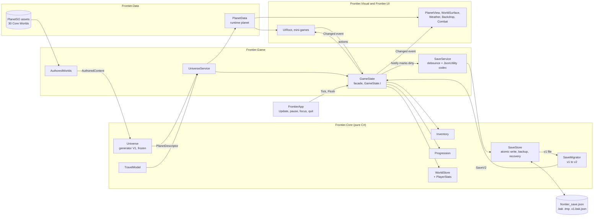

# Runtime model (as built)

How a world, a game session and a save file fit together since the foundation rework. Everything in this document exists, is
tested and is what the game runs today. The target design is in [ROADMAP.md](ROADMAP.md) sections 2 and 4; how the pieces behave in
play is in [SYSTEMS.md](SYSTEMS.md); the assemblies are in [ARCHITECTURE.md](ARCHITECTURE.md).

Three ideas carry the design:

1. **Every planet comes from the generator.** A world is a pure function of `(universe seed, generator version, coordinates)`.
   The 30 hand made Core Worlds are *authored content* merged into the same universe, so the game has one planet type for both.
2. **Only deltas are saved.** The save holds what the player changed (structures, warehouse contents, waves, visits) keyed by the
   canonical planet id, plus the player's own state. Everything else is regenerated.
3. **Engine-free logic, thin Unity shell.** Inventory, progression, the per-world store, the save protocol, the migrator and the
   travel formula live in `Frontier.Core` (no `UnityEngine`, also compiled by the plain .NET test project). `GameState` is a facade
   that composes them with the ScriptableObject data.

## 1. The pieces

**Economy content milestone:** the export can now be imported and validated as ScriptableObjects in a separate
`Frontier/EconomyDatabase` resource. The live database and this document's runtime/save model have **not** switched
to those values. See [CONTENT.md](CONTENT.md) for import ownership, reimport guarantees and the remaining runtime cutover.

| Type | Assembly | Role |
|------|----------|------|
| `Frontier.Universe.*` (`Universe`, `UniverseConfig`, `PlanetDescriptor`, `StarSystem`, `PlanetKey`, `AuthoredContent`, ...) | Core | The deterministic generator (V1 is frozen, see [SYSTEMS.md](SYSTEMS.md)). Immutable descriptors. |
| `PlanetBlurb`, `PlanetSeeds`, `LegacyHash` (`Core/Flavor`) | Core | Short deterministic description of a generated world; the stable 64 bit visual seed; the historical string hash that keeps the look of authored worlds. |
| `Inventory`, `IdAmount` | Core | Slot based backpack, id based. Capacity and stack sizes are functions supplied by the host. Same rules as the original `GameState` (an old copy of the algorithm is the oracle of `InventoryParityTests`). |
| `Progression` | Core | Xp, level curve (`1 + floor(sqrt(xp / base))`, float arithmetic like before), upgrade levels. |
| `WorldStore`, `PlanetDelta`, `StructureRecord`, `StorageRecord`, `StackRecord`, `PlayerStats` | Core | Per-planet deltas keyed by canonical planet id (structures, warehouse storages, waves, visits) and the numbers behind the future Frontier Score. These classes are also the save schema. |
| `WarehouseOps` | Core | Deposit / withdraw / move between the backpack and a warehouse grid (conservation: nothing is ever discarded). |
| `IClock`, `SystemClock`, `FakeClock`, `UtcText` | Core | Wall clock plus a monotonic clock; the fake one drives tests. Timestamps in saves are ISO 8601 text. |
| `HarvestMapping` | Core | The one function that maps a generator `HarvestMethod` to a `MinigameKind` (TODO for the new mini-games). |
| `ITravelCostModel`, `TravelModel`, `TravelNode` | Core | Interim travel distance and fuel cost (section 6). |
| `SaveV2` (+ `PlayerSave`, `LocationSave`, `ClockSave`, `CreatedWithInfo`, reserved `WalletEntry` / `BuilderSlot` / `SettingEntry`), `SaveSchema`, `SeedText` | Core | The save file schema v2: plain `[Serializable]` classes with public fields (Unity's `JsonUtility` has no dictionaries). |
| `SaveDataV1`, `SaveMigrator`, `IWorldIdMap`, `MigrationContext` | Core | The legacy v1 type and the pure function v1 -> v2. |
| `SaveStore`, `ISaveCodec`, `SaveLoadReport`, `SaveDebouncer`, `JsonShape` | Core | The file protocol (atomic write, `.bak`, recovery, read-only mode) and the debounce rule, all over a codec interface. |
| `PlanetSO` + the 30 assets, `GameDatabase`, `ModelLibrary`, `PlanetGenerator`, `DefaultContent` | Data | Authoring format of the Core Worlds and the content lookups. `PlanetSO` is *only* authoring data now. |
| `PlanetData` | Data | The runtime planet used by every system. Wraps a `PlanetDescriptor`, its `StarSystem` and the optional `PlanetSO`. |
| `AuthoredWorlds` | Game | Converts the `PlanetSO` assets and `PlanetSO.Systems` into universe `AuthoredContent` (section 4). |
| `UniverseService` | Game | Owns the `Universe`, the authored worlds, a 128 entry cache of generated `PlanetData`, home, lookups, travel pricing. Implements `IWorldIdMap`. |
| `GameState` (+ `PlacedStructure`) | Game | The facade the UI, visuals and combat use (`GameState.I`). Composes the Core services, `UniverseService` and `SaveService`. |
| `SaveService`, `SaveSerializer` | Game | Debounced persistence on top of `SaveStore`; the `JsonUtility` codec. |
| `FrontierApp` | App | Lifecycle MonoBehaviour: ticks the state each frame and flushes on pause, focus loss, quit and destroy. |

## 2. Data flow



Reading it: the generator and the authored assets meet in `UniverseService`, which hands out `PlanetData`. Presentation reads
`PlanetData` and observes `GameState.Changed`; it never touches the Core services directly. A change calls `Notify()`, which only
marks the save dirty; `FrontierApp` writes after a second of quiet and immediately when the app is paused or closed.

## 3. Planets

`PlanetData` exposes what the code used to read from `PlanetSO`:

* **Identity and numbers:** `Id` (canonical), `AuthoredId` (null for generated worlds), `Name`, `Description`, `Tier`, `Danger`,
  `WorldSize`, `BuildingSlots` (at least 12), `StructureScale` (`1 / WorldSize`: bigger worlds have more pads and smaller structures
  but look the same size on screen).
* **Look:** `Primary`/`Secondary`/`Rim`, `Weather`, `Mood`, `HasRings`, `MoonCount`, `Style`, `GlowIntensity`, `AtmosphereIntensity`,
  `SurfaceBands`, `ModelKey`, `ModelScale`, `SurfaceRadius`, `ModelRadius`, `AtmosphereScale`, and the stable 64 bit `Seed`.
* **Gameplay lists:** `Resources` (ordered, one per deposit, scrap last), `Spots` and `SpotsFor(MinigameKind)` built from the
  descriptor's deposits (label from the resource and harvest method; yield = base yield x richness; difficulty from the deposit). The
  Mine game also offers the surface scrap first, exactly as before.
* **Debugging:** `Dump()` writes a readable descriptor (the debug menu copies it to the log and the clipboard).

**Authored vs generated.** An authored world reads every presentation value live from its `PlanetSO` (authored values win, and
in-editor tuning keeps working). A generated world uses the descriptor plus fixed defaults: `AtmosphereScale` 5, `ModelScale` 1,
`Mood` Auto, `ModelRadius` 1.5. Compare worlds with `Id` / `Equals`, never `==`: the generated cache may hand out a new object for the
same world.

**Ground radius.** All planet meshes are fitted by bounding box to a diameter of 3, which makes spiky or lens shaped meshes smaller
than their bounds. Each `ModelLibrary` entry therefore carries a baked `groundScale` (0.70 for the spiky `planet_2` family `ferrum`,
`cinder`, `nyx`, `obsidian`, `vesper`; 0.87 for the lens shaped `arbor`, `mire`, `kaos`; 1 otherwise). A generated world's
`SurfaceRadius` is `1.5 x groundScale`, so pads and buildings touch the visible body while the planet keeps its on-screen size.
`Frontier > Bake Model Ground Radii` recomputes the values; the planet check fails when they are stale. Authored worlds keep their
`PlanetSO.surfaceRadius`.

**Visual seed.** Never `string.GetHashCode`. Authored worlds use the historical .NET Framework string hash of their id (reimplemented
in `LegacyHash`, so their hand tuned surface pattern is identical on every platform); generated worlds use an independent hash stream
of `(universe seed, planet key)`. The surface pattern, the moon orbits and the clear-sky backdrop mood are derived from it.

**Mini-game mapping.** `HarvestMapping.ToMinigame` is the single place: Chop/Mine/Drill map one to one; Siphon -> Drill,
Excavate -> Mine, Salvage -> Mine, Harvest -> Chop until the new mini-games exist (roadmap 6.2).

**Rendering every biome.** The authoring enum `PlanetBiome` has the same twelve names as the generator's `Biome` (Desert, Oceanic,
GasGiant and Barren were added), and a test keeps them equal. Crater pattern (style 2) renders as black and white dice when its cells
are big and the palette is dark, so generated worlds get at least 9 bands and the shader property `_CraterSoft = 1` (terrain shows
between the discs); authored worlds keep `_CraterSoft = 0`, the original look.

## 4. Ids

| Kind | Form | Notes |
|------|------|-------|
| Planet | `p:X:Y:I:P` | Canonical `PlanetKey` text: sector X, Y, system index I in the sector, planet index P in the system. The only planet id in a v2 save. |
| System | `s:X:Y:I` | `SystemKey` text. Generated systems use I < 1000; **authored systems use I >= 1000** (`SystemKey.AuthoredBase`). |
| Core World (legacy) | `sylva`, `glacia`, ... | `PlanetSO.id`, kept as `PlanetDescriptor.AuthoredId`. `UniverseService.Get("sylva")` and the migrator resolve it; nothing writes it any more. |
| Resource, structure, upgrade | `ResourceSO.id`, `StructureSO.id`, `UpgradeSO.id` | Plain strings. **Never rename one**: saves reference them. |
| Universe seed | 16 hex digits | `createdWith.universeSeed` (`SeedText`). Default `0x46524F4E54494552` ("FRONTIER"). |

**Authored key assignment (frozen by `AuthoredWorldsTests`).** System index = `1000 +` the system's position in `PlanetSO.Systems`
(sylva 1000, ember 1001, verdance 1002, umbra 1003, frost 1004, edge 1005). Planet index = position in the canonical orbit order
table in `AuthoredWorlds` (inner to outer). The sector is the one that contains the system's position. Examples:
`sylva = p:0:0:1000:0`, `glacia = p:0:0:1000:1`, `cinder = p:3:0:1001:0`, `zephyr = p:3:-5:1004:1`, `genesis = p:14:-15:1005:3`.
To add a Core World: add the asset, **append** its id to its system's list (never insert or reorder), add its biome to the biome
table, extend the golden table in the test. A world missing from the order table is appended in id order.

**Placement of the authored systems.** Sylva sits at the origin. Every other system lies in the direction it had on the old map,
at the distance where `Universe.TierAt` gives its average authored tier (inverse of the tier formula), kept inside 92 % of the home
galaxy's radius (the Verdant Spiral, 1,700 ly; the position is quantized to 0.01 ly and the system is assigned to that galaxy
explicitly, because near the rim the density falls below the threshold that assigns a position to a galaxy). In the shipped universe the closest generated system to
a Core World system is 22.8 ly away; a test asserts that no generated system comes closer than the generator's minimum separation
(8 ly), so authored and generated systems never overlap.

| System | Distance (ly) | Tier at position | Authored tiers | Note |
|--------|--------------:|-----------------:|---------------:|------|
| sylva | 0 | 0 | 0-2 | home |
| ember | 213 | 3 | 2-4 | |
| verdance | 362 | 4 | 3-4 | |
| frost | 362 | 4 | 3-5 | |
| umbra | 590 | 5 | 4-6 | |
| edge | 1,298 | 7 | 6-8 | pulled in from about 1,486 ly by the galaxy margin |

Orbit radius and phase of each Core World come from the old map layout (`AuthoredWorlds.Orbits`), so the system view stays
consistent. Deposits are the old gather spots with richness 1.

## 5. Session services and `GameState`

`GameState` keeps the public API the UI used (`Add`, `Spend`, `Has`, `Craft`, `Place`, `UpgradeStructure`, `Travel`, `Deposit`,
`Withdraw`, `WaveCleared`, `Level`, `EffectSum`, `ToolLevel`, ...) and the `ResourceSO` / `StructureSO` / `UpgradeSO` convenience
overloads; the Core services underneath use string ids. Fields: `backpack` (`Inventory`), `progression`, `world` (`WorldStore`),
`stats` (`PlayerStats`), `universe`, `saves`, `clock`, `planet` (the current `PlanetData`). `gs.structures` is a derived list of
`PlacedStructure` (record + `StructureSO`), rebuilt when `WorldStore.Version` changes.

* **Travel** spends fuel through the cost model, records the arrival (visit, first visit, `worldsLanded`, `maxDistanceFromHomeLy`),
  notifies and flushes immediately.
* **Visits.** A world gets a `PlanetDelta` as soon as it is visited (`visits`, first/last visit, `discovered`). `DebugTeleport`
  records a visit but not a landing in the stats.
* **Play time.** `Tick()` adds frame time (frames longer than 5 s are ignored: the app was suspended) and marks the state dirty
  every 60 s so the stat survives a crash.

## 6. Travel (interim)

Everything that prices a trip goes through `ITravelCostModel`; the economy work package replaces `TravelModel` without touching
callers.

* **Distance.** Same system: straight line between the two orbits in AU (law of cosines on `OrbitRadius`/`OrbitPhase`). Different
  systems: light-years between the stars.
* **Fuel.** Same system `min(3 + 1.0 x AU, 8)`; different systems `11 + 0.017 x ly`. Multiplied by the engine efficiency
  (`GameState.FuelMultiplier`, 1 down to 0.25), rounded up, at least 1. An inter-system hop is never cheaper than a same-system hop.
* **Calibration.** Sylva -> Glacia and Sylva -> Ferrum stay 5 fuel (asserted in `TravelModelTests` and `UniverseServiceTests`); against
  the old map-distance fuel costs of the 30 authored worlds the new formula is off by about 19 % on average (measured once while
  calibrating, not asserted). The 12 expansion worlds that never had a map position now cost like system neighbours.

## 7. Save v2

### 7.1 Files (all in `Application.persistentDataPath`, or `GameState.SaveDirectoryOverride`)

| File | Meaning |
|------|---------|
| `frontier_save.json` | The save. |
| `frontier_save.json.bak` | The previous good save (rolling, one generation). |
| `frontier_save.json.tmp` | Exists only while a write is in progress, or after an interrupted one. |
| `frontier_save.v1.bak.json` | Copy of the original v1 file, made once before its first migration. |

### 7.2 Schema reference (`schemaVersion` 2)

| Field | Type | Meaning |
|-------|------|---------|
| `schemaVersion` | int | 2. A file without the field is the legacy v1 format (read as 0). |
| `saveId` | string | Random id created with the game, kept through migrations. |
| `createdWith.appVersion` | string | `Application.version` that created the save. |
| `createdWith.generatorVersion` | int | Universe generator version the worlds were created with (1). |
| `createdWith.universeSeed` | string | The universe seed, 16 hex digits (64 bit values are text). |
| `player.xp` | int | |
| `player.upgrades[]` | `{id, level}` | Upgrade levels above 0. |
| `player.inventory[]` | `{resourceId, count}` | The backpack as a count per resource; the slot layout is not stored. |
| `location.currentPlanetId` | string | Canonical planet id. An unknown id returns the player home with a warning. |
| `worlds[]` | `PlanetDelta` | **Only planets the player changed or visited.** Sorted by id so the file is stable. |
| `worlds[].planetId` | string | Canonical id. |
| `worlds[].structures[]` | `{defId, slot, level, buildEndUtc, upgradeEndUtc}` | Pad index and level; the two timestamps are reserved for the builder timers (empty today). |
| `worlds[].storages[]` | `{structureSlot, slots[{resourceId, count}]}` | A warehouse's grid, found by the pad of its structure. An empty slot has an empty `resourceId`. |
| `worlds[].wavesCleared` | int | |
| `worlds[].visits`, `firstVisitUtc`, `lastVisitUtc`, `discovered` | int, text, text, bool | UTC, ISO 8601. |
| `worlds[].clearedObstacles[]` | int[] | Reserved: obstacle indices cleared on the planet. |
| `stats` | `PlayerStats` | `maxDistanceFromHomeLy`, `worldsLanded`, `totalWavesCleared`, `playSeconds`: the inputs of the future Frontier Score. |
| `clock.lastSavedUtc` | string | When the file was written. |
| `wallet[]`, `builders[]`, `atlas[]`, `settings[]` | lists | **Reserved**, empty today. They are loaded and written back unchanged so later work packages can fill them without a new schema number. |

A minimal example:

```json
{
  "schemaVersion": 2,
  "saveId": "5f0c9d1e8a3b4c7d9e2f1a0b3c4d5e6f",
  "createdWith": { "appVersion": "1.0", "generatorVersion": 1, "universeSeed": "46524F4E54494552" },
  "player": {
    "xp": 1850,
    "upgrades": [ { "id": "pack", "level": 2 } ],
    "inventory": [ { "resourceId": "fuel", "count": 12 }, { "resourceId": "wood", "count": 40 } ]
  },
  "location": { "currentPlanetId": "p:0:0:1000:1" },
  "worlds": [
    {
      "planetId": "p:0:0:1000:0",
      "structures": [ { "defId": "warehouse", "slot": 5, "level": 2, "buildEndUtc": "", "upgradeEndUtc": "" } ],
      "storages": [ { "structureSlot": 5, "slots": [ { "resourceId": "wood", "count": 64 }, { "resourceId": "", "count": 0 } ] } ],
      "wavesCleared": 4, "visits": 3, "firstVisitUtc": "2026-10-01T08:00:00.0000000Z", "lastVisitUtc": "2026-10-13T16:00:00.0000000Z",
      "discovered": true, "clearedObstacles": []
    }
  ],
  "stats": { "maxDistanceFromHomeLy": 0, "worldsLanded": 2, "totalWavesCleared": 4, "playSeconds": 5230.5 },
  "clock": { "lastSavedUtc": "2026-10-13T16:00:00.0000000Z" },
  "wallet": [], "builders": [], "atlas": [], "settings": []
}
```

### 7.3 Write protocol (`SaveStore.Write`)

1. Serialize to `frontier_save.json.tmp` and flush it to disk.
2. Re-read the temp file and verify it (complete JSON object; schema, save id, xp and list sizes match the state).
3. If the current primary file is readable, copy it to `frontier_save.json.bak`.
4. Replace the primary with the temp file (`File.Replace`; a copy-and-delete fallback covers file systems without it).

A failed write deletes the temp file, leaves the primary untouched and retries after 5 s (`SaveService.RetrySeconds`); the message
is in `SaveService.LastError`.

### 7.4 Load protocol and the report

`primary -> .bak -> .tmp -> new game`: the first file that parses wins. `GameState.LoadReport` (a `SaveLoadReport`) says what
happened: `source` (`NewGame`, `Primary`, `Backup`, `TempRecovery`), `migratedFrom` (0 when the file was already v2), `recovered`,
`error`, `readOnly`, `schemaVersion` and a `warnings` list (dropped unknown ids, unknown world, other universe seed). A migrated or
recovered save is rewritten at once, so the next start reads a clean v2 file.

* **Newer schema (or newer generator version).** The file is loaded but **never overwritten**: `SaveStore.ReadOnly` is set, the
  session plays on, and `SaveService.LastError` / `GameState.SaveIsReadOnly` tell the UI why.
* **Unknown ids.** Resources, upgrades, structure definitions and worlds the build does not know are dropped from the loaded state
  with a warning (a world falls back to home). The migrator itself keeps unknown world ids verbatim so no data is destroyed.

### 7.5 Debounce and lifecycle

`GameState.Notify()` fires `Changed` and marks the save dirty; it never writes. `SaveDebouncer` decides when: **1.0 s without
further changes, but at most 10 s after the first unsaved change** (a player who taps continuously still gets saved).
`FrontierApp` calls `GameState.Tick()` every frame and `GameState.Flush()` on `OnApplicationPause(true)`, focus loss, quit and
destroy. `Travel`, `ResetProgress`, a migrated or recovered load and (later) a purchase flush immediately. `Save()` writes
unconditionally and `Flush()` only when dirty; both stay public for tests and the harness.

## 8. How to add a field safely

1. **Add it to the POCO in `Frontier.Core`** (`PlanetDelta`, `PlayerSave`, `PlayerStats`, ...) as a public field with a default that
   means "never set". `JsonUtility` leaves fields missing from the file at their initializer, so older files keep loading, and it
   ignores fields it does not know, so a save from a newer build still parses. Use lists of small classes (never dictionaries),
   ISO text for times, text for 64 bit values.
2. **Write and read it** in `GameState.BuildSave` / `Apply` (player data) or `WorldStore.Export` / `Import` (per-world data). If a
   per-world field should keep an otherwise untouched planet in the save, include it in `PlanetDelta.HasContent`.
3. **Prefer a reserved section** (`wallet`, `builders`, `atlas`, `settings`) when the data is key/value shaped.
4. **No schema bump** for an added field with a default. Bump `SaveSchema.Current` (and write a migrator step) only when an existing
   field changes meaning, is renamed or removed, or must be computed from other data at load.
5. **Test it:** extend the round trip in `SaveStoreTests` / `SaveFormatTests` and, if it is derived data, `GameStateTests`.
6. Never rename an id (resource, structure, upgrade, authored planet) that a save can contain.

## 9. Migration policy

* Schema numbers are monotonic integers. The build always writes `SaveSchema.Current`.
* A migration is a **pure function in Core** from the old POCO to the next one, written against a **real save fixture** of the old
  format (`Tests/EditMode/Fixtures`, built by running the real old build) and tested in the plain .NET project. Chains run in
  order (v1 -> v2 today; v2 -> v3 next, never a skip).
* The migrator never throws on odd content: unequal parallel lists are cut to the shortest, duplicates keep the first, unknown
  planet ids are kept verbatim, and everything questionable goes to `warnings`.
* Before the first migration the source file is copied to `frontier_save.v<N>.bak.json` (once).
* **Generator versions.** A planet keeps the generator version it was first generated with (`Universe.GetPlanet(key,
  storedGeneratorVersion)`); V1 is frozen, a later change ships as V2 and only affects worlds nobody has seen. A save whose
  `createdWith.generatorVersion` is newer than the build is read-only. *Not built yet:* the per-planet stored version that a V2
  generator will need (add it to `PlanetDelta` as a defaulted field, no schema bump).
* A different `universeSeed` in a save only produces a warning (the worlds will look different).

## 10. Debug tools

Gated by `#if UNITY_EDITOR || DEVELOPMENT_BUILD` (the menu hides them in release builds). **Menu > Debug > Generated world**
teleports to the first generated world that matches a chosen biome, size and minimum tier (searching up to 3,000 sectors around
home; **Next match** cycles), and **Dump descriptor** copies `PlanetData.Dump()` to the log and the clipboard. The harness
(`tools/capture-screens.ps1`) uses `GameState.DebugTeleport`, `DebugPlace` and `DebugSetStructureLevel` the same way.

## 11. Where it is tested

| Area | Tests |
|------|-------|
| Inventory parity (10,000 seeded random operations against the old algorithm), progression | `Core/InventoryParityTests`, `Core/ProgressionTests` |
| World store, warehouse conservation | `Core/WorldStoreTests`, `Game/StorageTests`, the Storage check suite |
| Travel | `Core/TravelModelTests` |
| Save: v1 -> v2 migration, v2 round trip, corrupt primary -> `.bak`, leftover temp, future schema, debounce | `Core/SaveMigratorTests`, `Core/SaveStoreTests`, `Core/SaveDebouncerTests`, `Game/SaveFormatTests`, `Game/SaveRoundTripTests` (fixtures `save_v1_fresh.json`, `save_v1_midgame.json`) |
| Authored worlds: conversion, ids, golden key table, tier consistency, determinism | `Game/AuthoredWorldsTests` |
| Generated planets: 500 random worlds resolve, stable seeds, ground radius, every biome | `Game/UniverseServiceTests`, `Game/PlanetRuntimeTests`, `Game/PlanetBiomeTests`, `Game/PlanetDataTests`, `Universe/PlanetFlavorTests` |
| Facade, debounce with a fake clock, travel and visits | `Game/GameStateTests` |
| Lifecycle and rendering of every world kind | `PlayMode/SmokeTests` |

## 12. Known gaps

* The star map still draws the 30 authored worlds from `PlanetSO.mapPosition`; a generated current world appears as a marker only
  (semantic zoom, fog of war and the Worlds card belong to the map work package).
* `TravelModel` is a stop-gap (no jump range, fuel densities or multi-hop routes yet).
* Authored worlds with the spiky or lens models keep their authored `surfaceRadius`, so their buildings can still float a little.
* Siphon, Excavate, Salvage and Harvest deposits play the nearest existing mini-game (`HarvestMapping`).
* The universe golden digests have not been run on an IL2CPP/ARM64 device (see [TESTING.md](TESTING.md)).
